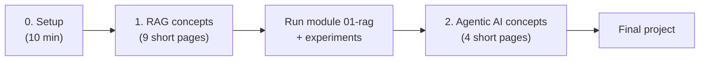

# Agentic System Design

My learning repo for a **Gen AI / Agentic System Design** course: concept notes with diagrams,
runnable exercises, and a final project.

> **Written for beginners, including future me.** Every concept page explains *why* before
> *how*, uses diagrams and real examples from our code, and ends with **"Check yourself"**
> questions (click to reveal the answer). If something doesn't click, run the code and come
> back; it gets clearer each time.

## 🧭 Start here



| Step | What | Link |
|---|---|---|
| 0 | Install tools and run your first script | [Environment setup](docs/setup/environment.md) |
| 1 | Learn RAG: why, chunking, embeddings, chunk size and k, when (not) to use, testing | [RAG learning path](docs/concepts/01-rag/README.md) |
| 2 | Run the RAG agent and do the experiments | [Module 01 – RAG](modules/01-rag/README.md), [Module 02 – AST chunking](modules/02-semanticrag-with-ast/README.md), [Module 03 – Lexical RAG](modules/03-lexicalrag/README.md) |
| 3 | Learn agents: the loop, building blocks, agentic RAG, use cases | [Agentic AI learning path](docs/concepts/02-agentic-ai/README.md) |
| 4 | Build the final project | [Project](project/README.md) |

Stuck on a word? → [Glossary](docs/glossary.md)

📅 **Where am I in the course?** → [Course roadmap](docs/course-roadmap.md): all 5 sections, each
topic linked to its doc, with ✅ / 🟡 / ⚪ status. Currently: **week 1, section 1**.

## 📚 Concepts

### 01 – RAG (Retrieval-Augmented Generation)

| # | Page | Key question it answers |
|---|---|---|
| 1 | [Why RAG?](docs/concepts/01-rag/01-why-rag.md) | What problem does RAG solve? With vs. without RAG |
| 2 | [Chunking](docs/concepts/01-rag/02-chunking.md) | Why cut documents into pieces? How? |
| 3 | [Embeddings and vector search](docs/concepts/01-rag/03-embeddings.md) | How does "search by meaning" work? |
| 4 | [Chunk size and k](docs/concepts/01-rag/04-chunk-size-and-k.md) | What happens with small/big chunks and small/big k? How to choose? |
| 5 | [When to use RAG, and when not](docs/concepts/01-rag/05-when-to-use-rag.md) | RAG vs. SQL, APIs, grep, long context; use cases by industry |
| 6 | [Testing a RAG system](docs/concepts/01-rag/06-evaluating-rag.md) | How do I know a change made it better? |
| 7 | [Chunking code with AST](docs/concepts/01-rag/07-chunking-code-with-ast.md) | What is an AST? Why does it chunk code better? What does it miss? |
| 8 | [Lexical search and BM25](docs/concepts/01-rag/08-lexical-search-and-bm25.md) | How does keyword search work? Why does it find exact names? |
| 9 | [Semantic vs. lexical, and Hybrid RAG](docs/concepts/01-rag/09-hybrid-rag.md) | When to use which? How do you combine both? |

### 02 – Agentic AI

| # | Page | Key question it answers |
|---|---|---|
| 1 | [What is an agent?](docs/concepts/02-agentic-ai/01-what-is-an-agent.md) | LLM call vs. workflow vs. agent; the agent loop |
| 2 | [Building blocks](docs/concepts/02-agentic-ai/02-building-blocks.md) | Model, instructions, tools, memory, planning, guardrails |
| 3 | [Agentic RAG](docs/concepts/02-agentic-ai/03-agentic-rag.md) | How is it different from classic RAG? |
| 4 | [Use cases](docs/concepts/02-agentic-ai/04-use-cases.md) | Where agents shine, and when NOT to use one |

## 🧪 Modules (code + experiments)

| # | Module | Notes | Code | Status |
|---|--------|-------|------|--------|
| 01 | RAG | [README](modules/01-rag/README.md) · [test cases](modules/01-rag/test_cases.md) | [1_semantic_rag.py](modules/01-rag/1_semantic_rag.py), [2_eval_rag.py](modules/01-rag/2_eval_rag.py) | 🟡 In progress |
| 02 | Semantic RAG with AST chunking | [README](modules/02-semanticrag-with-ast/README.md) | [1_semantic_rag_ast.py](modules/02-semanticrag-with-ast/1_semantic_rag_ast.py) | 🟡 In progress |
| 03 | Lexical RAG (BM25) | [README](modules/03-lexicalrag/README.md) | [1_bm25_visualization.py](modules/03-lexicalrag/1_bm25_visualization.py), [2_lexicalrag.py](modules/03-lexicalrag/2_lexicalrag.py) | 🟡 In progress |

<!-- Add a row per module: | 02 | Agents | [README](modules/02-agents/README.md) | ... | ⚪ Not started | -->

## 🔗 References

Good LinkedIn posts, articles and images collected along the way: [docs/references.md](docs/references.md).

## 📁 Repo layout

```
Agentic-System-Design/
├── README.md              ← you are here
├── CLAUDE.md              ← instructions Claude Code reads automatically
├── pyproject.toml, uv.lock← one shared Python environment (uv)
├── .env.example           ← API key names (copy to .env)
├── docs/
│   ├── setup/             ← environment setup
│   ├── concepts/
│   │   ├── 01-rag/        ← RAG learning path (9 pages)
│   │   └── 02-agentic-ai/ ← Agentic AI learning path (4 pages)
│   ├── assets/images/     ← pictures used in the docs (e.g. from LinkedIn posts)
│   ├── templates/         ← template for module READMEs
│   ├── course-roadmap.md  ← the course's 5 sections and what's covered so far
│   ├── references.md      ← collected posts and articles
│   └── glossary.md        ← terms and definitions
├── modules/               ← one numbered folder per course module (code + notes)
├── sample_data/           ← shared data the exercises run against
└── project/               ← final capstone project
```

> 💡 Main diagrams are illustrated SVG images (made by `docs/assets/images/_src/make_diagrams.py`).
> Smaller flow diagrams use **Mermaid**, which GitHub draws as pictures automatically. In VS Code, install
> the "Markdown Preview Mermaid Support" extension to see them in the preview.
