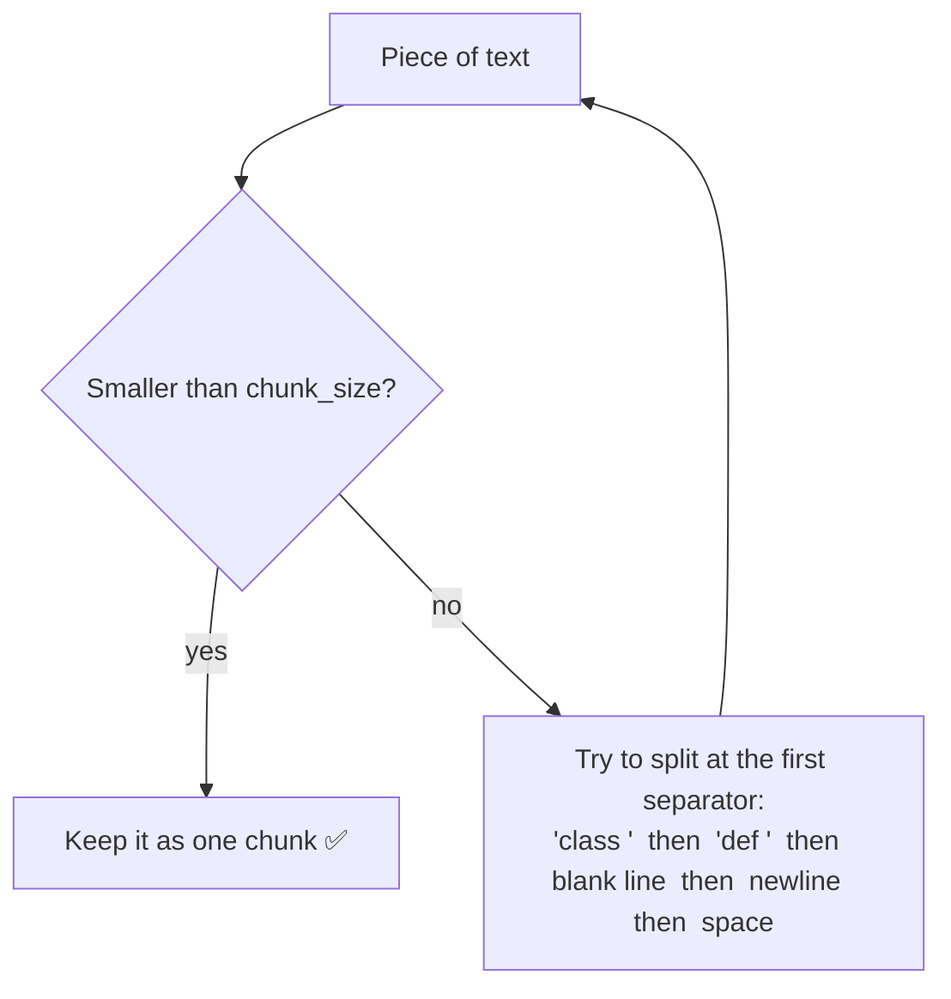

# 2. Chunking

> ⏱ 10 min · Prerequisites: [Why RAG?](01-why-rag.md) · [← Learning path](README.md) · [Next: Embeddings →](03-embeddings.md)

## In one sentence

**Chunking means cutting documents into small pieces, so search can return just the part that
answers the question, not the whole document.**

## Why do we need it?

Imagine searching a 300-page book and getting back "the whole book". Technically correct,
useless in practice. We want **the paragraph** that answers the question.

```
 Without chunking                        With chunking
 ────────────────                        ─────────────
 ┌──────────────────────┐                ┌──────┐┌──────┐┌──────┐
 │ billing.py           │                │chunk1││chunk2││chunk3│ ...
 │ (all 59 lines,       │                └──────┘└──────┘└──────┘
 │  many topics)        │                    ▲
 └──────────────────────┘                    └── only this one is about
   1 file = 1 search result                      "task limits" → return it
```

There are **four reasons**, and each one matters:

| # | Reason | What goes wrong without chunking |
|---|---|---|
| 1 | **Precision** | One vector for a whole file = an average of *all* its topics, so it matches nothing well. ([Embeddings](03-embeddings.md) explains why.) |
| 2 | **Embedding model limit** | Models read a maximum length. `all-MiniLM-L6-v2` reads ~256 tokens; **everything after that is silently ignored**. |
| 3 | **Prompt size and cost** | You'd send whole files to the LLM for every question. |
| 4 | **Citations** | "Answer found in billing.py, `check_task_limit`" is more useful than "somewhere in billing.py". |

## How chunking works

You choose two numbers:

- **`chunk_size`**: the maximum size of each piece. In our code it's measured in **characters**.
- **`chunk_overlap`**: how many characters neighbouring pieces share.

### Why overlap?

Without overlap, a sentence that sits on a boundary gets cut in half, and neither piece makes
sense alone. Overlap repeats a little text at each border:

```
 Text:  [ A A A A A A B B B B B B C C C C C C ]

 No overlap:        [A A A A A A] [B B B B B B] [C C C C C C]
                                ↑ an idea on this border is cut in two

 With overlap:      [A A A A A A B]
                              [A B B B B B B C]
                                         [B C C C C C C]
                    ↑ each border is repeated in both pieces
```

Typical overlap: **10–15% of chunk size**. Our code uses `chunk_size=256, chunk_overlap=32` (12.5%).

## Chunking strategies

| Strategy | How it cuts | Good for | Weakness |
|---|---|---|---|
| **Fixed size** | Every N characters, no matter what | Quick experiments | Cuts words and sentences in half |
| **Recursive** (what we use) | Tries big natural breaks first (blank lines), then smaller ones (lines, spaces) | Most text | Still only counts characters |
| **Language-aware** | Like recursive, but knows `class` / `def` for code, `#` headings for Markdown | Code, Markdown | Only as smart as its separator list (see below!) |
| **By document structure** | One chunk per section / heading / function | Manuals, docs with headings, code | Sections can be very uneven in size |
| **Semantic** | Uses embeddings to cut where the topic changes | Long free-flowing text | Slower, more complex |

### How the recursive splitter decides where to cut



It tries the **biggest, most natural** break first, and only falls back to smaller breaks
when a piece is still too big.

## 🔍 A real surprise in our code

LangChain's Python splitter uses these separators, in order:

```
'\nclass '   '\ndef '   '\n\tdef '   '\n\n'   '\n'   ' '   ''
```

Look at `'\n\tdef '`. It looks for a **tab** before `def`. Our code (like almost all Python)
indents methods with **4 spaces**, not tabs. So **methods inside a class never match**, and
the splitter falls back to blank lines and line breaks.

Result at `chunk_size=256`: `check_task_limit` (531 characters) is cut into pieces like this:

```python
# ── chunk A ──────────────────────────────────────────────────────────────
def check_task_limit(self, user: User) -> None:
        """Raise BillingError if user has reached their plan_tier task cap."""
        plan = self.get_plan(user)
        limit = TASK_LIMITS.get(plan, TASK_LIMITS[PlanTier.FREE.value])

# ── chunk B ──────────────────────────────────────────────────────────────
current_count = len(self.db.list_tasks(owner_id=user.id))
        if current_count >= limit:
            raise BillingError(
                f"Task limit reached for plan '{plan}': {current_count}/{limit}. "

# ── chunk C ──────────────────────────────────────────────────────────────
#   "Upgrade your plan_tier to create more tasks." ... (the rest)
```

Chunk B has the key logic, `if current_count >= limit`, **but not the function name**.
A search for "check_task_limit" finds chunk A, which doesn't contain the actual check.

Numbers for the whole `sample_project` (30,503 characters, overlap ≈ 12% of chunk size):

| `chunk_size` | Chunks | Average chunk length | `check_task_limit` |
|---|---|---|---|
| 256 | 173 | 172 chars | cut into 3 pieces |
| 512 | 93 | 325 chars | cut into 2 pieces (531 chars is just over 512) |
| 1024 | 46 | 667 chars | 1 whole piece, plus neighbouring code |

> Notice: the average is well **below** `chunk_size`. The splitter cuts at natural breaks, so
> most chunks come out smaller than the maximum.

✍️ **Experiment idea:** pass custom separators that use 4 spaces (`"\n    def "`) and compare
chunk hits with [2_eval_rag.py](../../../modules/01-rag/2_eval_rag.py).

## Common beginner mistakes

| Mistake | Why it's wrong |
|---|---|
| "chunk_size=256 means 256 words" | In our splitter it's **characters**. 256 characters ≈ 5–8 lines of code. Other tools count **tokens**. Always check. |
| "Each chunk is exactly chunk_size long" | It's a **maximum**. Most chunks are smaller. |
| "No overlap is fine" | Ideas on the borders get cut in half. |
| "One chunk size fits all data" | FAQ answers are short, legal clauses are long, functions vary. Match the chunk to the *size of a typical answer* ([page 4](04-chunk-size-and-k.md)). |

## Check yourself

<details>
<summary>1. Why not embed each whole file as one vector?</summary>

The vector becomes an average of every topic in the file, so it matches no question precisely.
Also, the embedding model would ignore everything after its max length (~256 tokens for
MiniLM), and you'd send whole files to the LLM every time.
</details>

<details>
<summary>2. What problem does overlap solve?</summary>

Text that sits on a chunk border would be cut in half. Overlap repeats the border text in both
neighbouring chunks, so the idea stays whole in at least one of them.
</details>

<details>
<summary>3. Our splitter is "Python-aware". Why does it still cut check_task_limit in the middle?</summary>

Its separator for methods is `'\n\tdef '` (tab + def), but our methods are indented with spaces.
So it never splits at method boundaries, and falls back to blank lines and line breaks.
</details>

---

[← Why RAG?](01-why-rag.md) · [Next: Embeddings and vector search →](03-embeddings.md)
