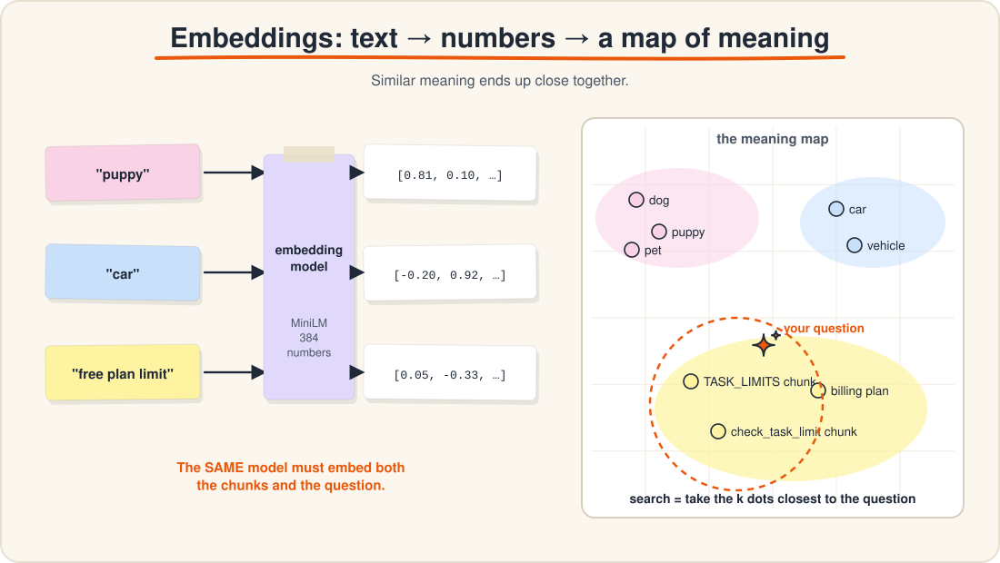
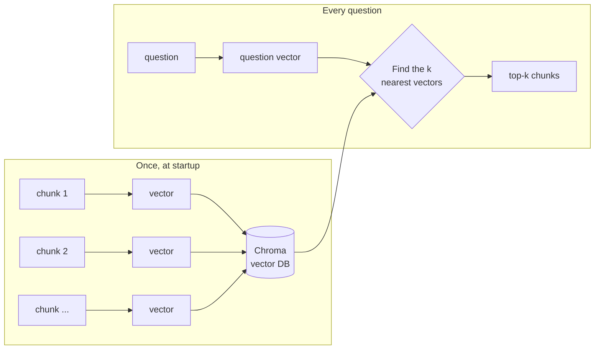

# 3. Embeddings and vector search

> ⏱ 15 min · Prerequisites: [Chunking](02-chunking.md) · [← Learning path](README.md) · [Next: Chunk size and k →](04-chunk-size-and-k.md)

## In one sentence

**An embedding turns a piece of text into a list of numbers, so that texts with similar
_meaning_ get similar numbers.**

## Why do we need it?

Computers compare **words** easily, but not **meaning**:

```
 Question:  "Why can't free users create more tasks?"
 Code:      "if current_count >= limit: raise BillingError"

 Shared words?   none   →  keyword search (grep) finds nothing ❌
 Same meaning?   yes    →  embedding search finds it ✅
```

Embeddings let us search by **what text is about**, not by which exact words it uses.

## What an embedding looks like

```
 "free users task limit"     ──► embedding model ──►  [ 0.12, -0.48, 0.33, ..., 0.07 ]
                                 (all-MiniLM-L6-v2)     └──────── 384 numbers ────────┘
```

- Our model, `all-MiniLM-L6-v2`, produces **384 numbers** per text, always, whether the text is
  one word or a whole paragraph.
- Each number is like a "score" on some hidden aspect of meaning. Humans can't read them
  individually; what matters is **how close two lists are**.

## The map analogy

Imagine every text is a dot on a map. Similar meanings sit close together:



A real embedding has **384 directions** instead of 2, but the idea is identical:
**close dots = similar meaning**.

## How vector search uses this



1. **Index (once):** embed every chunk and store the vectors in a **vector database** (we use Chroma).
2. **Search (every question):** embed the question with **the same model**, then find the `k`
   stored vectors that are closest to it.

### How is "closest" measured?

| Measure | Idea | Score meaning |
|---|---|---|
| **Distance** (Chroma default) | Straight-line distance between two dots | **Lower** = more similar |
| **Cosine similarity** | The angle between two arrows | **Higher** = more similar (max 1.0) |

`2_eval_rag.py` prints Chroma's **distance**, e.g. `billing.py (0.62)`. Lower is better.

## Keyword search vs. embedding search

| | Keyword search (grep, BM25) | Embedding search |
|---|---|---|
| Matches | Exact words | Meaning |
| "refund late" finds "delayed reimbursement" | ❌ | ✅ |
| Exact names like `check_task_limit`, `INV-0042` | ✅ Perfect | ⚠️ Can miss or confuse |
| Typos, synonyms, other languages | ❌ | ✅ |
| Needs a model | No | Yes |

Neither is always better. Real systems often combine both: **hybrid search**.

> 💡 This is why test **T4a vs. T4b** in [test_cases.md](../../../modules/01-rag/test_cases.md)
> asks the same thing in two ways: once with the exact name `check_task_limit`, once in
> plain English.

## Golden rules

```
 1. SAME model for chunks and questions.
    Vectors from different models live on different "maps", so comparing them is meaningless.

 2. Change the model → re-embed EVERYTHING.
    (Our script rebuilds the index on every run, so you get this for free.)

 3. Mind the max length.
    MiniLM reads ~256 tokens. A 1024-character chunk of code can be longer than that.
    The end of the chunk is then IGNORED when embedding, without any warning.
```

## Choosing an embedding model

| Model | Size | Notes |
|---|---|---|
| `all-MiniLM-L6-v2` (ours) | Small, fast, runs locally | Good baseline. 384 numbers, ~256 token limit |
| `BAAI/bge-small-en-v1.5` | Small, runs locally | Often better retrieval quality; try it with `--model` |
| Hosted APIs (OpenAI, Voyage, Cohere…) | No local install | Usually stronger; cost per use; data leaves your machine |
| Code-specific models | Varies | Trained on code; can match names and logic better |

```bash
uv run modules/01-rag/2_eval_rag.py --model BAAI/bge-small-en-v1.5 --retrieval-only
```

## Common beginner mistakes

| Mistake | Why it's wrong |
|---|---|
| "The embedding model is the LLM" | They're different models. The embedder (MiniLM) only turns text into numbers. The LLM (gpt-4o-mini) writes answers. |
| "Embeddings understand everything" | They capture *general* meaning. Very specific names, IDs and numbers often match poorly. |
| "Close vector = correct answer" | Close means *similar topic*. The chunk may still not contain the answer. |
| "The vector DB stores only numbers" | It stores the vector **and** the original chunk text **and** metadata (like `source`). The text is what goes to the LLM. |

## Check yourself

<details>
<summary>1. In one sentence, what is an embedding?</summary>

A list of numbers that represents the meaning of a piece of text, so similar meanings get
similar (nearby) numbers.
</details>

<details>
<summary>2. Why must the question be embedded with the same model as the chunks?</summary>

Each model builds its own "map". A vector from model A has no meaningful position on model B's
map, so the distances would be nonsense.
</details>

<details>
<summary>3. A user searches for invoice "INV-2024-0042". Is embedding search a good choice?</summary>

No. It's an exact ID. Embedding search may return INV-2024-0024 because it "looks similar".
Use a database lookup or keyword search.
</details>

<details>
<summary>4. Chroma shows distance 0.45 for chunk A and 0.90 for chunk B. Which is more similar?</summary>

Chunk A. For distance, lower = closer = more similar.
</details>

---

[← Chunking](02-chunking.md) · [Next: Chunk size and k →](04-chunk-size-and-k.md)
