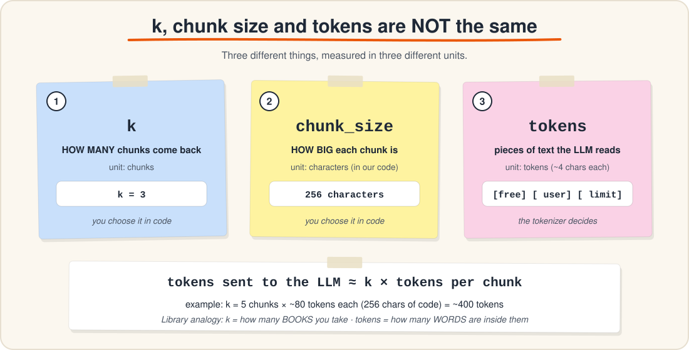
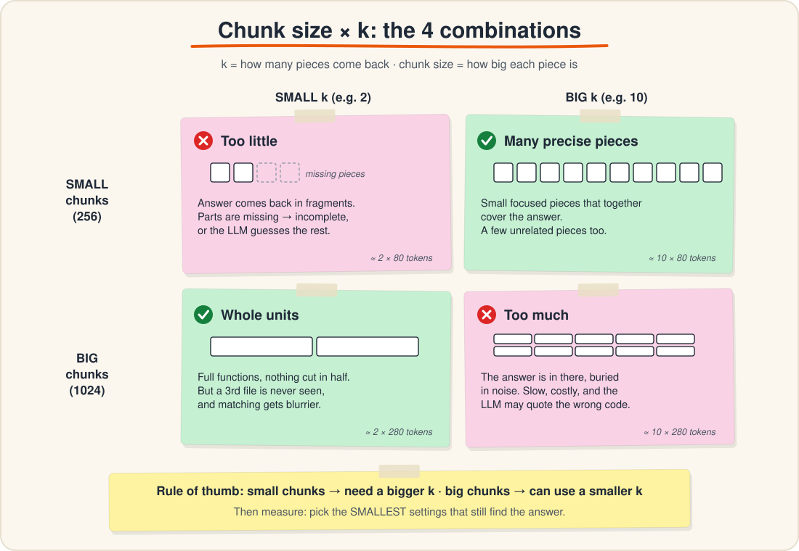
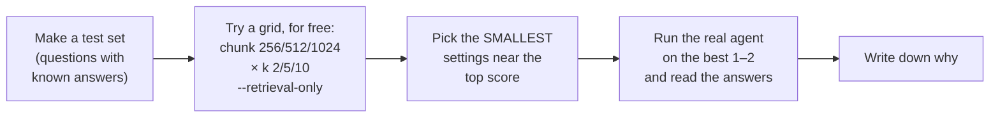

# 4. Chunk size and k: the two main knobs

> ⏱ 15 min · Prerequisites: [Chunking](02-chunking.md), [Embeddings](03-embeddings.md) · [← Learning path](README.md) · [Next: When to use RAG →](05-when-to-use-rag.md)

## In one sentence

**`chunk_size` decides how big each piece is; `k` decides how many pieces you hand to the LLM.
Together they decide what the LLM gets to see.**

## The two knobs

```
 chunk_size  = how big is each piece?          k = how many pieces do we retrieve?

 ┌──┐ ┌──┐ ┌──┐  small                          k=2   ▶ [■][■]
 ┌──────┐ ┌──────┐  medium                      k=5   ▶ [■][■][■][■][■]
 ┌────────────┐  big                            k=10  ▶ [■][■][■][■][■][■][■][■][■][■]
```

They're connected by one simple formula:

```
 text the LLM sees per search  ≈  k  ×  chunk_size
```

| Setting | ≈ Characters sent | Compared to our whole codebase (30,503 chars) |
|---|---|---|
| chunk 256 × k 2 | 512 | 2% |
| chunk 256 × k 5 (our default) | 1,280 | 4% |
| chunk 512 × k 5 | 2,560 | 8% |
| chunk 1024 × k 5 | 5,120 | 17% |
| chunk 1024 × k 10 | 10,240 | **34%**, about a third of everything! |

At some point you've stopped *retrieving* and started *dumping*.

## ⚠️ k, chunk size and tokens are NOT the same thing

Beginners often mix these up. They are three different things, in three different units:



| | Counts | Unit | Who decides | Example |
|---|---|---|---|---|
| **k** | how many chunks come back | chunks | you, in code | `k = 5` |
| **chunk_size** | how big each chunk can be | characters (in our splitter) | you, in code | `256` |
| **tokens** | how much text the LLM reads (and you pay for) | tokens (≈ 4 characters of English) | the tokenizer | "free user" = 2 tokens |

So `k = 5` doesn't mean 5 tokens. It means 5 chunks, which together are roughly 400 tokens
at `chunk_size=256`.

## Why they depend on each other

Think about **one answer** that is 530 characters long, like `check_task_limit`:

```
 chunk_size = 256                       chunk_size = 1024
 ───────────────                        ─────────────────
 answer is split into ~3 pieces         answer fits in 1 piece
 ┌────┐┌────┐┌────┐                     ┌─────────────────────────────┐
 │ A  ││ B  ││ C  │                     │ ███ answer ███ + other code │
 └────┘└────┘└────┘                     └─────────────────────────────┘
 you need k ≥ 3 just to                 k = 1 or 2 is enough,
 collect this one answer                but each piece carries noise
```

So:

```
 SMALL chunks  ──►  need a BIGGER k     (to collect all the pieces)
 BIG chunks    ──►  can use a SMALLER k (each piece already holds a lot)
```

## The four combinations



### 1. Small chunks + small k (e.g. 256 × 2): "too little"

```
 Question: "Walk me through TaskService.create_task"   (answer = 882 chars, ~4 chunks)

 retrieved:  [■ piece 1][■ piece 3]          missing: [□ piece 2][□ piece 4]
 LLM sees:   2 fragments, ~512 chars
 Result:     ❌ incomplete answer: "it checks permissions and... (stops)"
             ❌ or it fills the gaps by GUESSING
```

✅ Fine **only** for tiny answers: "What's the default role?" → one line → one small chunk.

### 2. Small chunks + big k (e.g. 256 × 10): "many precise pieces"

```
 retrieved:  [■][■][■][■][■][■][■][■][■][■]   10 small, focused pieces
 Result:     ✅ usually finds all parts of the answer, plus a few unrelated pieces
             ⚠️ pieces may arrive out of order, so the LLM must stitch them together
```

Good default for **precise questions** and **cross-file questions** (T7: scheduler + task service).

### 3. Big chunks + small k (e.g. 1024 × 2): "whole units, few of them"

```
 retrieved:  [████████ whole function + neighbours ████████][████████████████]
 Result:     ✅ full functions, nothing cut in half
             ❌ if the answer is in a 3rd file, it's simply not there
             ⚠️ each vector mixes several topics, so matching is "blurrier"
             ⚠️ MiniLM only reads ~256 tokens, so the end of a big chunk may be ignored
```

Good for **"explain this whole function"** questions (T5, T6).

### 4. Big chunks + big k (e.g. 1024 × 10): "too much"

```
 retrieved:  [████][████][████][████][████][████][████][████][████][████]
 LLM sees:   ~10,000 chars, a third of the codebase
 Result:     ✅ the answer is almost certainly in there...
             ❌ ...buried in noise. The LLM may quote the WRONG function
             ❌ slower and more expensive on every question
```

### Summary table

| | **Small k** | **Big k** |
|---|---|---|
| **Small chunks** | ❌ Fragments. Misses parts of the answer. ✅ OK for one-line facts. | ✅ Precise pieces that cover the answer. ⚠️ Some noise. |
| **Big chunks** | ✅ Whole functions. ❌ Misses other files. ⚠️ Blurry matching. | ❌ Too much text: noise, cost, wrong quotes. |

## What happens when you change one knob

| You change… | What improves | What gets worse | Watch for |
|---|---|---|---|
| chunk_size ⬆ | Fewer cut-off functions | Blurrier matches, embedder truncation, more noise per chunk | Chunk hits for one-line facts (T1–T3) dropping |
| chunk_size ⬇ | Sharper matches for small facts | Answers split into fragments | Chunks starting mid-function: `) -> Task:` |
| k ⬆ | More likely to include the answer | More noise, cost, latency; more chances to quote the wrong code | Hallucinations on T9, T10 |
| k ⬇ | Cleaner, cheaper prompts | Right chunk ranked 4th is never seen | File hits ❌ on cross-file tests (T7) |

## "So what are the best values?"

**There's no universal best value.** It depends on **how big a typical answer is** in your data.

### Step 1: look at your data

```
 What is ONE "answer unit" in my data?

 FAQ bot          → one Q&A pair          (~300–800 chars)   → smallish chunks
 Our code         → one function          (~100–1,500 chars) → medium chunks
 Legal contracts  → one clause            (~500–2,000 chars) → medium-big chunks
 Chat logs        → one message thread    (varies a lot)     → split by structure
```

**Goal: one chunk ≈ one answer unit.** Not much smaller (fragments), not much bigger (noise).

### Step 2: pick k from the question type

```
 Answer lives in ONE place     ("default role?")              → k = 2–5
 Answer spread over 2–3 places ("does scheduler notify?")     → k = 5–10
 Summaries / "list all X"      ("all permission checks")      → RAG struggles; consider other tools
```

### Step 3: measure, don't guess



Why "smallest"? If two settings score almost the same, the smaller one is **cheaper, faster
and less noisy**.

```bash
# Step B as one command (9 runs, no LLM, no cost)
for cs in 256 512 1024; do for k in 2 5 10; do
  uv run modules/01-rag/2_eval_rag.py --retrieval-only --chunk-size $cs --k $k --save
done; done
```

Then fill in the grid in [test_cases.md](../../../modules/01-rag/test_cases.md#choosing-chunk-size-and-k).

### A common starting point

If you have no data yet: **medium chunks (~500–1,000 characters) with ~10–15% overlap, k = 5**.
Then measure and adjust. Treat it as a starting guess, not an answer.

## When tuning numbers stops helping

Sometimes no combination works well. That's a sign the problem isn't the numbers:

| Symptom | Real fix (not a number) |
|---|---|
| Functions are always cut in half | Split by structure (one chunk per function). See the [separator surprise](02-chunking.md#-a-real-surprise-in-our-code). |
| Exact names (`check_task_limit`) aren't found | Add keyword search: **hybrid search** |
| The right chunk is found but ranked 7th | Add a **reranker** (a second model that re-sorts the top results) |
| The LLM mixes up files | Put the file name in each chunk's text or metadata |
| The LLM says "not found" when the chunk is there | Improve the prompt |
| The LLM invents things when nothing fits (T10) | Prompt rule: "if the chunks don't contain it, say so" |

## Check yourself

<details>
<summary>1. chunk_size=256 and k=2. A question needs a 900-character function. What happens?</summary>

The function is split into ~4 pieces, but only 2 are retrieved. The LLM sees half the logic:
the answer is incomplete, or it guesses the missing part.
</details>

<details>
<summary>2. Why can making chunks bigger make search WORSE for "what is the default role?"</summary>

The one-line answer is now mixed with lots of unrelated code in one vector. That vector
represents an average of many topics, so it matches the question less sharply, and the answer
is buried in noise.
</details>

<details>
<summary>3. Two settings both score 9/10 chunk hits: (256, k=10) and (1024, k=10). Which do you pick?</summary>

(256, k=10): about 2,560 characters vs ~10,240 per search, so it's cheaper, faster and less noisy
for the same retrieval quality.
</details>

<details>
<summary>4. A cross-file question (needs scheduler.py AND task_service.py) fails. Which knob first?</summary>

Raise **k**. The second file is probably ranked just below the cut-off.
</details>

---

[← Embeddings](03-embeddings.md) · [Next: When to use RAG →](05-when-to-use-rag.md)
