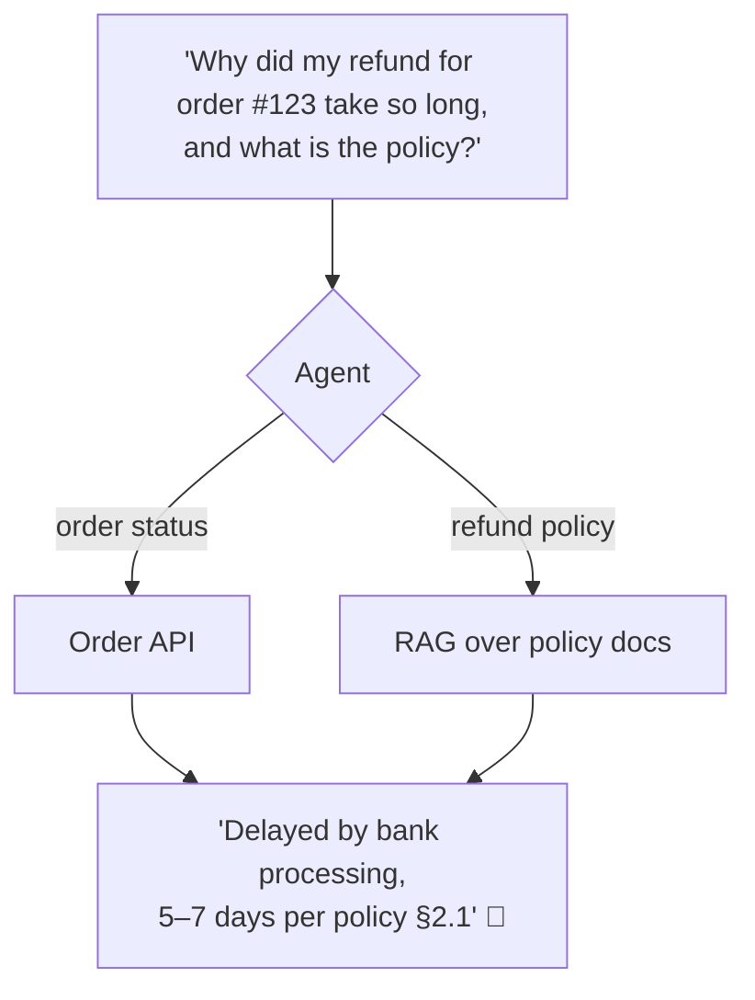

# 5. When to use RAG, and when not

> ⏱ 15 min · Prerequisites: [Why RAG?](01-why-rag.md) · [← Learning path](README.md) · [Next: Testing a RAG system →](06-evaluating-rag.md)

## In one sentence

**Use RAG when the answer is hidden in a large pile of text that the model has never seen;
use something simpler when the data is small, structured, live, or just code on disk.**

## The real question: where does the answer live?

Don't ask "should I use RAG?". Ask **"where is the knowledge, and what's the simplest way to
get it to the model?"**


## ✅ When to use RAG

| Signal | Example |
|---|---|
| **Too much text** to send every time | Support bot over 20,000 help articles |
| **Private data** the model never saw | "What's our travel reimbursement limit?" |
| Users ask in **their own words** | "my money got stuck" should find the "pending transaction" article |
| You need **citations** | Legal: "Clause 7.2 of Contract #4411 says…" |
| Data **changes often** | New FAQs every week: re-index, no retraining |
| Different users may see **different data** | An intern must not get answers from salary documents |
| **Many users**, so cost and speed matter | 10,000 employees asking an HR bot every day |
| **"Find similar"** questions | "Find past tickets like this bug" |

```
 Example: HR policy bot
 ──────────────────────
 "Can I carry forward leave?"
        │
        ▼
  500 HR PDFs ─► retrieve "Leave Policy §3" ─► "Yes, up to 10 days (Leave Policy §3)" 📎
```

## ❌ When NOT to use RAG (and what to use instead)

### 1. The model already knows → plain LLM
```
 "Explain what a REST API is"  ─► LLM answers directly ✅
 (RAG would only add cost and possibly irrelevant chunks)
```

### 2. The data is small → paste it in (long context)
```
 "Summarize this 10-page contract"  ─► send the whole document ✅
 (chunking could drop important context; the model can just read it all)
```

### 3. Code or files on disk → agentic search
```
 "Fix the bug in the login flow"  ─► grep → read → edit → test ✅
 (exact names and structure; embeddings would blur them)
```

### 4. Numbers and tables → SQL or a tool
```
 "Total sales in Q3 by region?"
   ❌ RAG: retrieves a few text chunks and can't add numbers reliably
   ✅ SQL: SELECT region, SUM(sales) FROM orders WHERE quarter='Q3' GROUP BY region
```
⚠️ **The most common mistake.** RAG *finds text*. It doesn't *count, sum or compare*.

### 5. Live data → API call
```
 "Is order #12345 shipped?"  ─► call the order service ✅
 (an index built yesterday is already out of date)
```

### 6. Behavior or style → prompt or fine-tune
```
 "Always reply in our brand voice, short and friendly"  ─► system prompt ✅
 (RAG adds facts, not behavior)
```

### 7. Exact IDs → database lookup
```
 "Show invoice INV-2024-0042"  ─► WHERE id = 'INV-2024-0042' ✅
 (semantic search may return INV-2024-0024: "similar", but wrong)
```

### 8. "List / count ALL of X" → a different tool
```
 "List every function that checks permissions"
   ❌ RAG returns only the top k (say 5), so it silently misses the rest
   ✅ grep "policy.require" finds every one
```

## Side by side

| Question | Best approach | Why not RAG? |
|---|---|---|
| "What is Kubernetes?" | Plain LLM | General knowledge |
| "Summarize this one PDF" | Long context | Small enough to send whole |
| "Fix the null-pointer bug" | Agentic search | Exact names and structure |
| "Revenue last quarter?" | SQL / tool | RAG can't calculate |
| "Weather in Hyderabad now?" | API | Needs live data |
| "Reply in our brand voice" | Prompt / fine-tune | Behavior, not knowledge |
| "Get order #123" | DB lookup | Exact ID |
| "List all permission checks" | grep | RAG only returns top k |
| **"Our refund policy for damaged items?"** | **RAG ✅** | Private, many docs, everyday language |
| **"Find incidents similar to this one"** | **RAG ✅** | Similarity over years of text |
| **"Which contracts mention data residency?"** | **RAG ✅** | Thousands of docs, needs citations |

## Quick checklist

```
 Is the data HUGE?                         ┐
 Is it UNSTRUCTURED text / PDFs?           │
 Do users ask in THEIR OWN words?          │  mostly YES  ──►  RAG
 Is it SPREAD across many systems?         │
 Do you need CITATIONS or PERMISSIONS?     │
 Many users, need FAST + CHEAP?            ┘

 Small → paste it · Structured → query it · Live → call it
 Local code → grep it · Behavior → prompt it · "All of X" → grep / SQL
```

## Real systems combine them

Most real assistants use **several** of these, and an **agent** chooses between them
([Agentic AI](../02-agentic-ai/README.md)):



## Use cases by industry

Each one is a good RAG fit because of the reason in the last column.

| Domain | Use case | Why RAG fits |
|---|---|---|
| Customer support | Bot over product docs | Users' words ≠ docs' words |
| Enterprise | Knowledge across Confluence, Slack, PDFs | Scattered, huge, behind APIs |
| Legal | Contract and case-law search | Search by concept + citations |
| Finance | Analyst over annual reports and earnings calls | Long PDFs, exact citations |
| Finance | Bank policy bot | Filter by region and version |
| Healthcare | Clinical guideline assistant | Must be grounded; no invented dosages |
| Healthcare | Patient history ("any allergies?") | Notes say "rash after amox"; the word "allergy" never appears |
| HR | Onboarding assistant, resume matching | Many systems; match by meaning |
| E-commerce | "comfy shoes for standing all day" | No product is titled that way |
| E-commerce | Answers from 12,000 reviews | Retrieve the 8 that matter |
| Education | Chat with your textbook | Answers from *your* syllabus |
| IT operations | Incident assistant over postmortems | "Similar past incident" search |
| Manufacturing | Technician + 1,000s of scanned manuals | Huge, unstructured, on a phone |
| Government | Citizen services in many languages | Embeddings match across languages |
| Personal | Second brain, chatbot memory | History too long for the prompt |
| Code (very large) | Search across 5,000 repositories | Too big to grep live |

### Three of these, drawn out

```
 Customer support
 "my card got declined abroad" ─► vector search ─► "International Payments FAQ" ─► answer 📎
                                  (grep "declined abroad" → 0 results)

 Incident assistant
 Alert: "DB latency spike" ─► 5 years of postmortems ─► "Mar 2025: connection pool
                                                          exhaustion → restart pgbouncer"

 Patient history
 "allergies?" ─► 10 years of notes ─► "2019: pt broke out after amox" ─► "Possible amoxicillin allergy"
```

## Check yourself

<details>
<summary>1. "How many orders did we get last week?" RAG or not?</summary>

Not RAG. It's a calculation over structured data, so use SQL or a tool. RAG would retrieve a
few text chunks and couldn't count reliably.
</details>

<details>
<summary>2. "Find all places in the code that call send_email." RAG or not?</summary>

Not RAG. "All of X" with an exact name is a grep job. RAG returns only the top k, so it would
silently miss some.
</details>

<details>
<summary>3. An insurance company has 40,000 policy PDFs, and agents ask "is water damage from a burst pipe covered?". RAG or not?</summary>

RAG. It's huge, unstructured, private, asked in everyday words, and needs citations to the clause.
</details>

<details>
<summary>4. Why do real assistants often use an agent on top of RAG?</summary>

One question can need several sources: live data from an API, policy text from RAG, numbers from
SQL. The agent decides which tool to use for which part.
</details>

---

[← Chunk size and k](04-chunk-size-and-k.md) · [Next: Testing a RAG system →](06-evaluating-rag.md)
