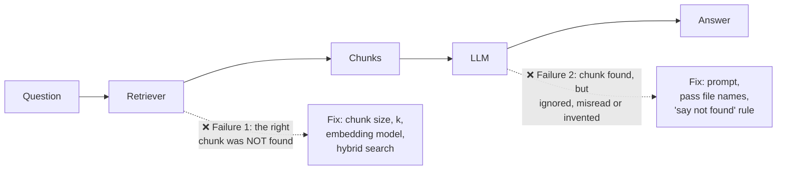
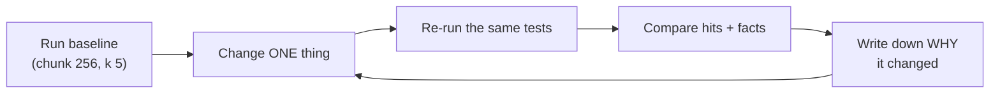

# 6. Testing a RAG system

> ⏱ 10 min · Prerequisites: [Chunk size and k](04-chunk-size-and-k.md) · [← Learning path](README.md) · Next: [run the module](../../../modules/01-rag/README.md)

## In one sentence

**Ask the same fixed questions, with known correct answers, after every change, and check
both what was _retrieved_ and what was _answered_.**

## Why do we need this?

Without a test set, you compare **different questions**, not **different settings**:

```
 Monday:   chunk=256 · "how does login work?"      → good answer 🙂
 Tuesday:  chunk=512 · "explain the scheduler"     → bad answer 🙁
           Was 512 worse? Or was the question harder? You can't tell.
```

With a fixed **eval set** (also called a **golden set**), you can:

```
 chunk=256 · same 10 questions → 6/10 correct
 chunk=512 · same 10 questions → 8/10 correct    ✅ now it's a fair comparison
```

## A RAG system can fail in two places



So for every question, check **two things**:

| Check | Question to ask | Where in `2_eval_rag.py` output |
|---|---|---|
| **Retrieval** | Did the right chunk come back? | **File hit** and **Chunk hit** |
| **Answer** | Is it correct and complete, with nothing invented? | Tick the **facts** boxes |

> ⚠️ **A good-looking answer can hide bad retrieval** (the LLM got lucky or guessed), and **bad
> retrieval can look fine** (the LLM filled gaps from general knowledge). That's why we check both.

## File hit vs. chunk hit

```
 Question: "What does check_task_limit do?"

 Retrieved:  billing.py, chunk A  (def check_task_limit... limit = ...)

 File hit:   billing.py ✅          ← right file
 Chunk hit:  "if current_count >= limit:" ❌   ← but NOT the lines with the answer
```

With small chunks, a file hit with a chunk miss is very common. **Chunk hit is the one that matters.**

## What to put in an eval set

Cover different **kinds** of questions, because each stresses a different knob:

| Type | Example (our tests) | Tests | Knob that matters most |
|---|---|---|---|
| Simple lookup | T1: free plan limit? | One small fact | Small chunks help |
| Same question, two wordings | T4a/T4b: exact name vs. plain English | Meaning vs. exact words | Embedding model |
| Whole function | T5, T6: walk me through `tick()` | Logic kept together | Big chunks help |
| Cross-file | T7: does the scheduler notify? | Several files at once | Bigger k helps |
| Trap | T9: "how is bcrypt used?" (it isn't) | Not repeating a misleading word | Prompt |
| Negative | T10: Stripe payments (don't exist) | Saying "not found" | Prompt, k |

Our full set, with expected answers: [modules/01-rag/test_cases.md](../../../modules/01-rag/test_cases.md).

## The experiment loop



**Change only one thing per run.** If you change chunk size *and* k together and the score
improves, you won't know which one helped.

## Free first, paid second

```
 --retrieval-only    No LLM. Uses your exact question as the search.
                     Free, fast, no API key. Tests Failure 1 only.

 (default: agent)    The LLM writes its own search queries, then answers.
                     Costs API calls. Tests both failures.
```

Do the big grid with `--retrieval-only`, then run the agent only on the best 1–2 settings.

> 💡 In agent mode the LLM **rewrites** your question before searching ("query rewriting"). The
> output shows its search queries. If T4a and T4b score the same in agent mode but differently in
> retrieval-only mode, the rewriting is helping.

## Check yourself

<details>
<summary>1. Why must the questions stay the same between runs?</summary>

So that any difference in score comes from the setting you changed, not from a harder or easier question.
</details>

<details>
<summary>2. File hit ✅, chunk hit ❌. What does that mean?</summary>

The right file came back, but not the piece with the actual answer. Usually the chunks are too
small (the answer was cut off into a chunk that wasn't retrieved) or k is too small.
</details>

<details>
<summary>3. The answer to T10 (Stripe) describes a payment flow. Is that a retrieval or an answer failure?</summary>

An answer failure (hallucination). There's no Stripe code, so retrieval *can't* succeed; the
retriever always returns k chunks anyway. The LLM should have said "I could not find that".
Fix it in the prompt.
</details>

---

[← When to use RAG](05-when-to-use-rag.md) · Next: [run the module](../../../modules/01-rag/README.md) and [Agentic AI →](../02-agentic-ai/README.md)
