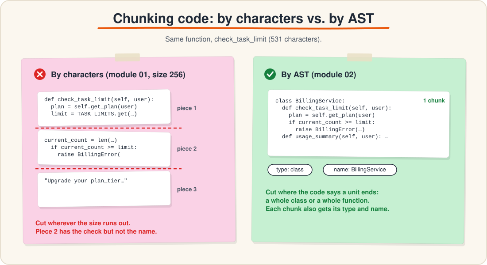
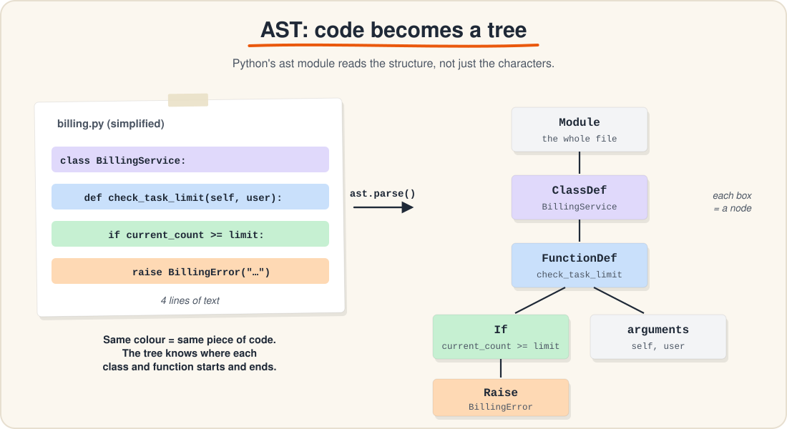
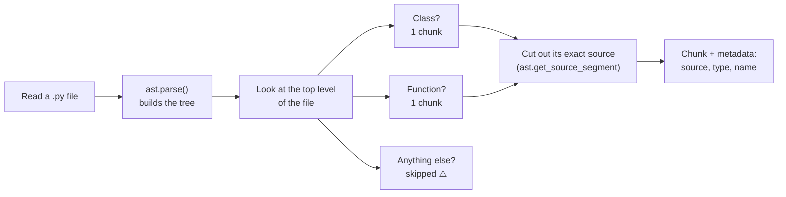
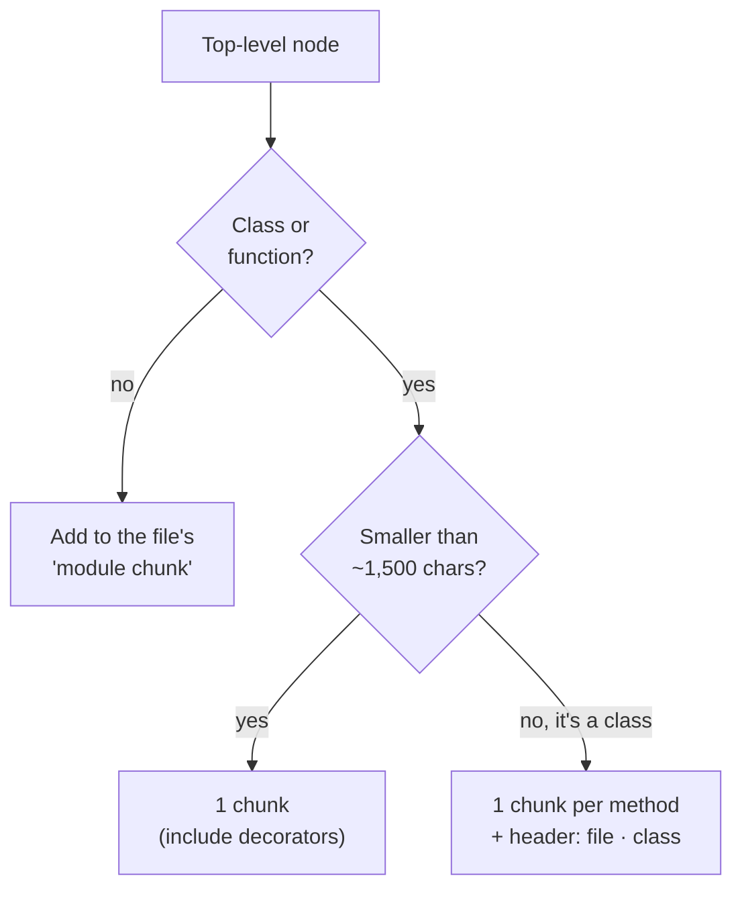

# 7. Chunking code with AST

> ⏱ 15 min · Prerequisites: [Chunking](02-chunking.md), [Chunk size and k](04-chunk-size-and-k.md) · [← Testing a RAG system](06-evaluating-rag.md) · [Learning path](README.md) · [Next: Lexical search and BM25 →](08-lexical-search-and-bm25.md) · Code: [module 02](../../../modules/02-semanticrag-with-ast/README.md)

## In one sentence

**An AST (Abstract Syntax Tree) turns code into a tree of its real parts (classes, functions,
`if`s, loops), so we can cut code into chunks where a unit _actually_ ends, instead of wherever
a character count runs out.**

## Why do we need it?

### Code isn't just text. It has structure.

To a character splitter, code is a long string. It doesn't know where a function starts or
ends, so it cuts wherever the size limit is reached. In [module 01](../../../modules/01-rag/README.md)
that cut `check_task_limit` into 3 pieces at `chunk_size=256`, and the piece with the actual
check (`if current_count >= limit`) didn't even contain the function's name
([details](02-chunking.md#-a-real-surprise-in-our-code)).



| Problem with character chunking | How AST chunking fixes it |
|---|---|
| Functions are cut in half | Each chunk is a **whole** class or function |
| A piece may lose its function name | The name is always at the top of the chunk, and also stored as metadata |
| You must guess a good `chunk_size` | No size to guess: the code decides where units end |
| The LLM receives fragments | The LLM receives complete, readable code |

That's why AST chunking **preserves context and improves retrieval quality** for code.

## What is an AST?

**AST = Abstract Syntax Tree.** It's how a program "understands" code:

- **Syntax**: it follows the grammar rules of the language (Python here).
- **Tree**: the parts are nested inside each other: a file contains classes, a class contains
  functions, a function contains `if`s, and so on.
- **Abstract**: it keeps the *meaning* and drops the *formatting* (extra spaces, brackets that
  change nothing, and comments).



Each box is a **node**. Every node knows its **type** (`ClassDef`, `FunctionDef`, `If`…) and
the **line numbers where it starts and ends**. That second part is what makes chunking possible:
"give me lines 44 to 53, the whole `check_task_limit` function".

### Why "abstract"? A tiny experiment

These two lines look different but mean the same thing:

```python
x = 1 + 2
x=(1+2)  # a comment
```

Python's `ast` module gives **exactly the same tree** for both:

```
Module
 └── Assign
      ├── target: Name  x
      └── value:  BinOp
                   ├── Constant 1
                   ├── Add
                   └── Constant 2
```

Spaces, the extra brackets and the comment are gone. Only the meaning is left.

> 🧪 **Try it yourself** (no install needed, `ast` is built into Python):
>
> ```bash
> python3 -c "import ast; print(ast.dump(ast.parse('x = 1 + 2'), indent=2))"
> ```

### The node types you'll meet most

| Node | What it is | Example |
|---|---|---|
| `Module` | The whole file (the root of the tree) | `billing.py` |
| `ClassDef` | A class | `class BillingService:` |
| `FunctionDef` / `AsyncFunctionDef` | A function or method | `def check_task_limit(...)` |
| `Assign` | A variable assignment | `TASK_LIMITS = {...}` |
| `If`, `For`, `While` | Conditionals and loops | `if current_count >= limit:` |
| `Import` / `ImportFrom` | Imports | `from models import User` |

## How module 02 chunks code



1. `ast.parse(code)` builds the tree for one file.
2. For each **top-level** node (directly inside the file, not nested): if it's a class or a
   function, it becomes one chunk.
3. `ast.get_source_segment(code, node)` cuts out exactly that node's source text, using the
   start and end positions stored in the node.
4. Each chunk gets metadata: `source` (file), `type` (`class` / `function`), `name`.
5. If a file can't be parsed (`SyntaxError`), the whole file becomes one chunk as a fallback.

### The numbers on our `sample_project`

| Chunking | Chunks | Average size | `check_task_limit` |
|---|---|---|---|
| Characters, 256 | 173 | 172 chars | cut into 3 pieces |
| Characters, 1024 | 46 | 667 chars | 1 piece, plus neighbouring code |
| **AST (module 02)** | **28** | **915 chars** | **whole, inside the `BillingService` chunk** |

Chunk sizes vary a lot with AST, because units vary a lot: the smallest is 39 characters, the
biggest (`TaskService`) is **4,543**.

## ⚠️ What AST chunking gets wrong (measured on our code)

AST chunking is better at keeping units whole, but this simple version has real gaps. Each one
below was checked by running the same logic on `sample_project`.

### 1. Code outside classes and functions is dropped

Only top-level classes and functions become chunks. Everything else at the top of a file is
skipped: constants, module docstrings, imports, and `if __name__ == "__main__":` blocks. In
total, about **16% of the characters** in `sample_project` are in no chunk at all.

| Dropped | File | Effect on our tests |
|---|---|---|
| `TASK_LIMITS = {FREE: 10, …}` | `billing.py` | **T1 (free plan limit) can't be answered** |
| `ROLE_PERMISSIONS = {VIEWER: {"task:view"}, …}` | `permissions.py` | **T3 (viewer actions) can't be answered** |
| Module docstring `"NOTE: … hash passwords (e.g. bcrypt)"` | `auth.py` | The misleading "bcrypt" word for T9 is gone |

### 2. Decorators are dropped

`ast.get_source_segment` starts at the `class` or `def` line, but decorators sit on the line
**above** it. So `@dataclass` is missing from 7 classes, such as `User`, `Task` and `ScheduledTask`.
The LLM then sees a plain class and doesn't know it's a dataclass.

### 3. Big classes become one big chunk

A whole class is one chunk, however big it is:

```
 TaskService chunk (4,543 chars)
 ├── __init__        starts at char    99
 ├── create_task     starts at char   503    ← T5's answer
 ├── complete_task   starts at char 1,386
 ├── ...
 └── search_tasks    starts at char 4,197

 TaskScheduler chunk (3,194 chars)
 ├── add_schedule    starts at char   478
 └── tick            starts at char 1,320    ← T6, T8's answer
```

Three effects:
- **Matching gets weaker.** The embedding model reads only about 256 tokens, which for code is
  very roughly the first ~800 characters (an estimate). Methods further down, like `tick()`,
  may not affect the chunk's vector at all.
  ([Why](03-embeddings.md#golden-rules))
- **Small chunks can outrank the real answer.** With `k=1`, "what is AuthService for?" got
  the 97-char `AuthError` chunk instead of `AuthService`
  ([real example](04-chunk-size-and-k.md#real-example-k--1-vs-k--4)).
- **Costs go up.** With `k=4`, the agent can receive up to ~13,000 characters if the biggest
  classes come back.

> 💡 **But note:** truncation only affects *matching*. If the chunk *is* retrieved, the LLM
> receives the **full** text, `tick()` included. Here the class docstring helps: it says
> "On each tick(), due schedules are materialized…", which is inside the part the embedder reads.

### 4. Small chunks can lose their context

This isn't a problem in module 02 yet, because it keeps whole classes. But once you split a
class into one chunk per method (fix #3 below), a chunk like `def tick(self, now=None): …` no
longer says which class or file it belongs to.

## How to improve it

These are ideas for your next experiments, from simplest to most work:

| # | Fix | Solves |
|---|---|---|
| 1 | Put all leftover top-level code of a file into one extra chunk ("module chunk") | Dropped constants → T1, T3 |
| 2 | Start each chunk at its first decorator (`node.decorator_list[0].lineno`) | Dropped `@dataclass` |
| 3 | If a class is too big, make **one chunk per method** instead | Weak matching, high cost |
| 4 | Add a header line to each chunk's text: `# billing.py · class BillingService` | Lost context (problem 4) |
| 5 | If a single function is still too big, split it with the character splitter as a fallback | Huge functions |



> ✍️ The `~1,500` limit above is just a starting guess. Measure it with the test cases, the same
> way you did for `chunk_size` in module 01.

## AST vs. character chunking: when to use which

| | Character chunking | AST chunking |
|---|---|---|
| Works on | Any text | Code only (one parser per language) |
| Keeps functions whole | ❌ | ✅ |
| Needs a size to tune | ✅ `chunk_size` | ⚠️ Only for very big units |
| Keeps top-level constants | ✅ | ❌ (unless you add a module chunk) |
| Chunk sizes | Even | Very uneven (39 to 4,543 chars here) |
| Setup effort | One line | A small function, like module 02 |
| Best for | Docs, PDFs, chat logs | **Code** |

> 🌍 **Other languages:** Python's `ast` only reads Python. For JavaScript, Java, Go and others,
> tools like **tree-sitter** build similar trees for many languages.

## Where else are ASTs used?

Any tool that needs to *understand* code, not just read it as text:


| Tool | What it uses the AST for |
|---|---|
| **Compilers and interpreters** | Understand the code, then turn it into something the computer can run. Python builds an AST before running every file. |
| **Linters and static analysis** (e.g. Ruff, pylint) | Find bugs and style problems by inspecting the tree: "this variable is never used", "this `except` is too broad". |
| **IDEs** (VS Code, PyCharm) | Autocomplete, "go to definition", and safe renaming: the tree shows where a name is *defined* vs. *used*. |
| **Formatters** | Rewrite layout while keeping the meaning the same. |
| **Code RAG** (module 02) | Cut code into whole classes and functions. |

## Common beginner mistakes

| Mistake | Reality |
|---|---|
| "AST chunking keeps all the code" | This simple version only keeps top-level classes and functions. Constants like `TASK_LIMITS` are dropped. |
| "Whole classes are always better" | Big classes make blurry, expensive chunks. Methods deep inside may not affect the vector at all. |
| "AST chunks don't need tuning" | You still choose *what* becomes a chunk (class vs. method) and *k*, and you still need to measure. |
| "The AST is the code" | It's the code's *structure*. Comments and formatting are gone. Use `get_source_segment` to get the original text back. |
| "`ast` works for any language" | Python only. Other languages need their own parser (e.g. tree-sitter). |

## Check yourself

<details>
<summary>1. In one sentence, why is AST chunking better than character chunking for code?</summary>

It cuts at the real boundaries of classes and functions, so each chunk is a complete, meaningful
unit instead of a fragment cut wherever a character limit ran out.
</details>

<details>
<summary>2. Why is it called "abstract"?</summary>

It keeps the meaning of the code but drops details that don't change it: extra spaces, extra
brackets and comments. `x = 1 + 2` and `x=(1+2)  # hi` give the same tree.
</details>

<details>
<summary>3. Module 02 can't answer T1 ("free plan task limit?"). Why?</summary>

`TASK_LIMITS` is a top-level constant, not a class or a function, so module 02 never puts it in
any chunk. The retriever can't find what was never indexed.
</details>

<details>
<summary>4. The TaskScheduler chunk is retrieved for T6. Does the LLM see tick(), even though the embedder may ignore that part?</summary>

Yes. Truncation only affects the *vector* (matching). Once the chunk is retrieved, the full
text, including `tick()`, goes into the prompt.
</details>

<details>
<summary>5. Name two tools other than RAG that rely on ASTs.</summary>

Any two of: compilers/interpreters, linters (Ruff, pylint), IDE features (autocomplete,
go to definition, rename), formatters.
</details>

---

[← Testing a RAG system](06-evaluating-rag.md) · [Back to learning path](README.md) · Code: [module 02](../../../modules/02-semanticrag-with-ast/README.md) · [Next: Lexical search and BM25 →](08-lexical-search-and-bm25.md)
