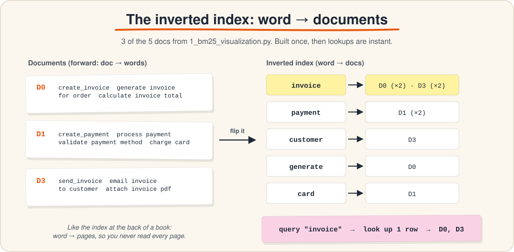
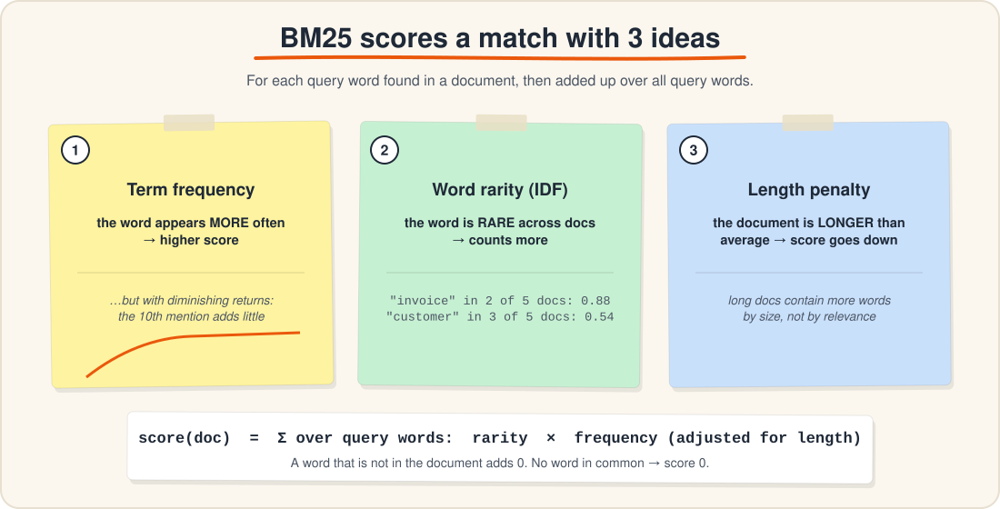

# 8. Lexical search and BM25

> ⏱ 15 min · Prerequisites: [Embeddings](03-embeddings.md), [Chunk size and k](04-chunk-size-and-k.md) · [← Chunking code with AST](07-chunking-code-with-ast.md) · [Next: Semantic vs. lexical →](09-semantic-vs-lexical.md) · Code: [module 03](../../../modules/03-lexicalrag/README.md)

## In one sentence

**Lexical RAG finds chunks by matching the exact words of the question (keyword search),
ranked with the BM25 formula, instead of matching meaning with embeddings.**

## Why do we need it?

Semantic search matches **meaning**. That's great for everyday questions, but it's weak at
**exact names**. You saw this yourself in module 02:

```
 Question: "what is AuthService for?"   (k = 1)

 Semantic search (module 02)  →  AuthError    ✗  (sounds similar, wrong class)
 Lexical search  (module 03)  →  AuthService  ✓  (the exact word matches)
```

In code, people often search for exact things: class names, function names, API names, error
messages, IDs. Lexical search is built for exactly that.

## Lexical RAG: same pipeline, different search

Only the **retriever** changes. Chunking, the agent and the prompt stay the same.

| Step | Semantic RAG (modules 01, 02) | Lexical RAG (module 03) |
|---|---|---|
| Prepare chunks | ✅ same | ✅ same |
| Turn chunks into… | **vectors** (embedding model) | **lists of words** (tokenizer) |
| Store them in… | a **vector DB** (Chroma) | a **BM25 index** |
| Find chunks by… | nearest vectors (meaning) | shared words, scored by **BM25** |
| Needs an embedding model? | Yes | **No** |

## How it works, in 3 steps

### Step 1: split text into words (tokenize)

Module 03's tokenizer turns code into searchable words:

```
 "def check_task_limit(self, user)"
   → ["def", "check_task_limit", "check", "task", "limit", "self", "user"]
```

- Lowercase everything, drop punctuation.
- Keep `snake_case` names **whole** (exact-name search) **and** split into parts, so
  "task limit" also matches `check_task_limit`.
- Drop **stop words** ("how", "the", "is"…) that appear everywhere and only add noise.

> ⚠️ `CamelCase` names are **not** split: `AuthService` becomes one word, `authservice`.
> So searching "auth service" (two words) does **not** find it. That's a tokenizer choice,
> and something you could improve.

### Step 2: build an inverted index

A normal document is **doc → words**. An inverted index flips it to **word → documents**,
like the index at the back of a book:



You build it once. After that, a query word jumps straight to the documents that contain it,
without reading every document. That's how search engines stay fast over millions of documents.

### Step 3: score the matches with BM25

**BM25 ("Best Matching 25")** decides *how good* each match is, using three ideas:



| Idea | In plain words | Why it makes sense |
|---|---|---|
| **Term frequency** | The word appears more often → higher score, but each extra mention adds less | A chunk that says "invoice" 3 times is probably about invoices, but 30 times isn't 10× better |
| **Word rarity (IDF)** | Rare words count more than common ones | "authservice" tells you a lot; "user" appears almost everywhere |
| **Length penalty** | Longer-than-average documents are scored down a little | Long documents contain more words by size, not by relevance |

The score for a chunk is the **sum over the query words** of *rarity × frequency (adjusted for
length)*. If a chunk shares **no** word with the query, its score is **0**.

> 💡 **BM25 vs. the inverted index.** Strictly, BM25 is only the **scoring formula**. The
> inverted index is the **data structure** that makes finding candidates fast. Search engines
> use both together, which is why they're often mentioned as one thing. BM25 is the default
> scoring in **Elasticsearch**, **OpenSearch** and **Apache Solr**.
> Module 03's `rank_bm25` library skips the inverted index and simply scores every chunk.
> That's fine for 173 chunks, but too slow for millions of documents.

## Real results on our code

Module 03's tokenizer + BM25 over `sample_project` (character chunks, size 256, 173 chunks):

| Query | BM25's #1 result | Verdict |
|---|---|---|
| `AuthService` | `auth.py`: `class AuthService:` | ✅ exact name |
| `Invalid or expired session token` (an error message) | `auth.py`: the exact line that raises it | ✅ exact text |
| `What is the task limit for a free plan user?` | `billing.py`: `def check_task_limit(...)` | ✅ shared words |
| `check_task_limit` | `scheduler.py` (a line that *calls* it); the function itself is #3 | 🟡 finds callers too |
| `auth service` (two words) | `main.py` (unrelated lines) | ❌ tokenizer keeps `authservice` whole |
| `How does the app process payments with Stripe?` | 3 docstrings that share a common word like "app" | ❌ "stripe" matches nothing; common words still score |

## The lexical gap: where BM25 fails

BM25 only knows **words**, not **meaning**. From `1_bm25_visualization.py`:

```
 Query: "generate bill"

 D3 "send_invoice email invoice to customer…"   → score 0   ✗
     (clearly about invoices, but "bill" ≠ "invoice" to BM25)
```

Synonyms ("bill" vs. "invoice"), other wordings ("stop users" vs. "limit") and other languages
all fall into this **lexical gap**. That's exactly what semantic search is good at, which is why
the next pages compare them and then combine them.

## Common beginner mistakes

| Mistake | Reality |
|---|---|
| "BM25 understands my question" | It matches words only. No synonyms, no meaning. |
| "Lexical search is old, so it's worse" | For exact names, IDs and error messages it often **beats** embeddings. |
| "The inverted index stores one document per word" | It stores, for each word, the **list** of documents that contain it (and how often). |
| "Score 0 can't happen" | It can, and it's useful: it means "no word in common". Module 03 returns nothing in that case. |
| "Tokenizing doesn't matter" | It decides what counts as a word. `AuthService` vs. "auth service" shows it. |

## Check yourself

<details>
<summary>1. What changes between semantic RAG and lexical RAG, and what stays the same?</summary>

Only the retriever changes: words + BM25 index instead of embeddings + vector DB. Chunking,
the agent, the tool and the prompt stay the same.
</details>

<details>
<summary>2. Why does a rare word count more than a common one?</summary>

A rare word narrows the search down to a few documents, so it tells you more. A common word
like "user" appears almost everywhere and barely helps decide which chunk is right.
</details>

<details>
<summary>3. "BM25 = inverted index + ranking algorithm". Is that exactly right?</summary>

Almost. BM25 itself is only the ranking formula. The inverted index is the data structure that
makes finding candidate documents fast. Search engines like Elasticsearch use both together.
</details>

<details>
<summary>4. A user asks "how do refunds work?" but the code only says "reverse_payment". Will BM25 find it?</summary>

No. There's no shared word, so the score is 0. That's the lexical gap; semantic search (or
hybrid search) is needed.
</details>

---

[← Chunking code with AST](07-chunking-code-with-ast.md) · [Back to learning path](README.md) · [Next: Semantic vs. lexical →](09-semantic-vs-lexical.md)
