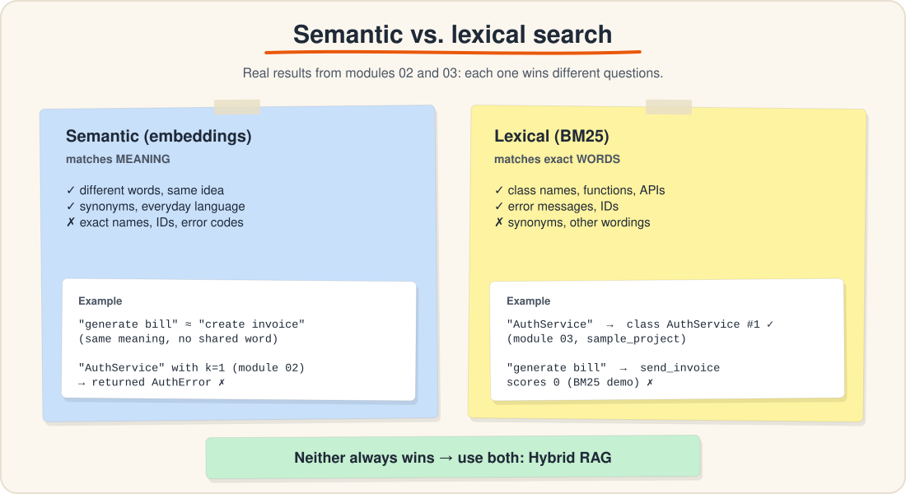
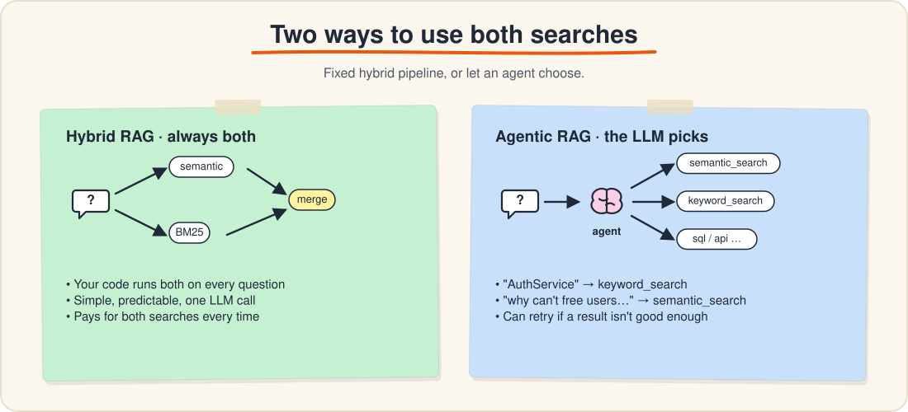

# 9. Semantic vs. lexical, and Hybrid RAG

> ⏱ 15 min · Prerequisites: [Embeddings](03-embeddings.md), [Lexical search and BM25](08-lexical-search-and-bm25.md) · [← Lexical search and BM25](08-lexical-search-and-bm25.md) · [Learning path](README.md)

## In one sentence

**Semantic search finds meaning, lexical search finds exact words; Hybrid RAG runs both and
merges the results, so each one covers the other's blind spot.**

## Why do we need both?

Each search fails on questions the other one handles well:



## When to use semantic, when to use lexical

| The question contains… | Example (our code) | Better search | Why |
|---|---|---|---|
| An exact class / function name | "What does `AuthService` do?" | **Lexical** | The exact word is in the code |
| An error message | "Invalid or expired session token" | **Lexical** | Exact text, word for word |
| An ID or code | "invoice INV-2024-0042" | **Lexical** | Meaning doesn't help with IDs |
| Everyday words for an idea | "How does the app stop users from creating too many tasks?" (T4b) | **Semantic** | The code says "limit", not "stop" |
| Synonyms | "generate bill" vs. code that says "create invoice" | **Semantic** | No shared word, same meaning |
| Another language | A question in Hindi about English docs | **Semantic** | Embeddings can match across languages |
| A mix: name + plain words | "Why does `check_task_limit` block free users?" | **Both** | Needs the exact name *and* the idea |

```
 Quick rule:
   Can you point to the exact word that will be in the answer?   → lexical
   Are you describing an idea in your own words?                 → semantic
   Not sure, or both?                                            → hybrid
```

### "Is it better to use just one of them?"

Usually **no**. Real users mix exact names and everyday words, and you can't know in advance
which kind of question comes next. Using both is the common choice.

Just one can be fine when your questions are always of one kind: for example, only exact
error-code lookups (lexical), or only "find similar support tickets" (semantic).

## Hybrid RAG: run both, merge the results


1. Send the question to **both** searches.
2. Each returns its own **ranked list** of chunks.
3. **Merge** the two lists into one.
4. Give the top `k` merged chunks to the LLM, as usual.

### How do you merge two lists?

You **can't just add the scores**. They're on different scales: a BM25 score might be `4.73`,
while a vector distance might be `0.62` (and for distance, *lower* is better). Adding them
would be like adding kilometres to kilograms.

The common fix is **Reciprocal Rank Fusion (RRF)**: ignore the scores and use only the
**rank** (1st, 2nd, 3rd…). Each list gives a chunk `1 / (60 + rank)` points, then you add
them up. (60 is a standard constant that keeps one list's #1 from dominating.)

| Chunk | Semantic rank | Lexical rank | RRF points | Final |
|---|---|---|---|---|
| A | 1 | 2 | 1/61 + 1/62 = **0.0325** | **#1** |
| C | 3 | 1 | 1/63 + 1/61 = **0.0323** | **#2** |
| B | 2 | (not found) | 1/62 = 0.0161 | #3 |
| D | (not found) | 3 | 1/63 = 0.0159 | #4 |

**Chunks that rank well in both lists rise to the top.** A chunk found by only one search can
still make it in, just lower down.

## Two ways to use both searches

Your notes describe two different designs. Both are valid:



| | Hybrid RAG | Agentic RAG (routing) |
|---|---|---|
| Who decides which search? | **Your code**: always both | **The LLM**: picks a tool per question |
| How | Fixed pipeline + merge (RRF) | Two tools: `semantic_search`, `keyword_search` |
| Searches per question | Always 2 | 1 or more, as the LLM decides |
| Predictable? | ✅ Yes | ⚠️ Less |
| Can retry? | ❌ No | ✅ If a result isn't good enough, the LLM searches again |
| Start with… | ✅ This one: simpler to build and to test | Once you have tools and evals in place |

> 🔁 That retry is the "loop" from the agent pages: the LLM reads a tool's result, decides
> it's not good enough, and calls a tool again ([agent loop](../02-agentic-ai/01-what-is-an-agent.md)).

## Beyond text: other kinds of data

The same idea extends to data that isn't plain text. Each kind of data needs its own way of
retrieving:

| Data stored in… | Retrieved with… | Often called |
|---|---|---|
| Text chunks (vectors) | Semantic search | Semantic / vector RAG |
| Text chunks (words) | BM25 | Lexical RAG |
| SQL database (tables) | Text-to-SQL | "SQL RAG" |
| Knowledge graph (entities + relations) | Graph queries | **Graph RAG** |
| Document database (e.g. MongoDB) | Its own queries or vector search | |

> 📌 **About the word "hybrid":** in most articles and tools, **hybrid search** means
> specifically **lexical + semantic**, as on this page. Combining many different sources
> (vectors + SQL + graph) is usually called **multi-source retrieval**, and it's most often
> done agentically: the LLM picks which source to ask.

## Common beginner mistakes

| Mistake | Reality |
|---|---|
| "Semantic search is newer, so it's always better" | It loses on exact names, IDs and error messages (the `AuthService` example). |
| "Just add BM25 and vector scores together" | Different scales. Merge by rank (RRF) instead. |
| "Hybrid means the LLM chooses the search" | That's routing / agentic RAG. Hybrid usually means *always both, then merge*. |
| "Hybrid fixes everything" | It still depends on good chunks and a sensible `k`. Measure it with the test cases. |

## Check yourself

<details>
<summary>1. A user searches for "ERR_TOKEN_EXPIRED". Semantic or lexical?</summary>

Lexical. It's an exact code; the answer contains exactly that text, and embeddings are weak at IDs.
</details>

<details>
<summary>2. Why can't you merge BM25 and vector results by adding their scores?</summary>

They're on different scales (and for vector distance, lower is better). RRF avoids this by using
only each chunk's rank in each list.
</details>

<details>
<summary>3. Chunk X is #1 in semantic search but not found by BM25. Chunk Y is #2 in both. Which wins with RRF?</summary>

Y: 1/62 + 1/62 ≈ 0.0323, while X gets only 1/61 ≈ 0.0164. Being good in both lists beats being
best in one.
</details>

<details>
<summary>4. What's the difference between hybrid RAG and agentic routing?</summary>

Hybrid: your code always runs both searches and merges them. Agentic routing: the LLM decides
per question which search tool to call, and can call again if the result isn't good enough.
</details>

---

[← Lexical search and BM25](08-lexical-search-and-bm25.md) · [Back to learning path](README.md) · Next: [Agentic AI →](../02-agentic-ai/README.md)
