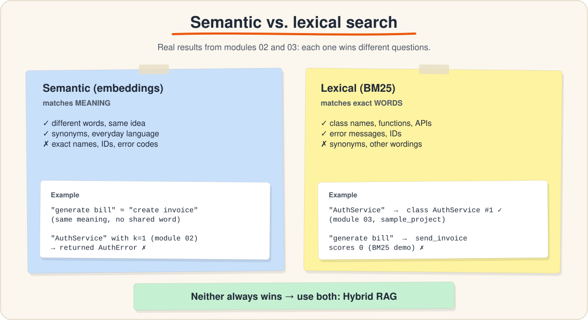

# 9. Semantic vs. lexical search

> ⏱ 10 min · Prerequisites: [Embeddings](03-embeddings.md), [Lexical search and BM25](08-lexical-search-and-bm25.md) · [← Lexical search and BM25](08-lexical-search-and-bm25.md) · [Learning path](README.md) · [Next: Hybrid RAG →](10-hybrid-rag.md)

## In one sentence

**Semantic search finds chunks with the same _meaning_; lexical search finds chunks with the
same _words_. Each one wins different questions.**

## Why does it matter which one you use?

Each search fails on questions the other one handles well. These examples come from our own
modules:



| | Semantic (embeddings) | Lexical (BM25) |
|---|---|---|
| Matches | Meaning | Exact words |
| Needs | An embedding model + vector DB | A tokenizer + BM25 index |
| Strong at | Synonyms, everyday wording, other languages | Class/function names, APIs, error messages, IDs |
| Weak at | Exact names, IDs, codes | Synonyms, other wordings |
| Our proof | "generate bill" ≈ "create invoice" | `AuthService` → `class AuthService` #1 |
| Our failure | k=1: `AuthService` → `AuthError` | "generate bill" → `send_invoice` scores 0 |

## When to use which

| The question contains… | Example (our code) | Better search | Why |
|---|---|---|---|
| An exact class / function name | "What does `AuthService` do?" | **Lexical** | The exact word is in the code |
| An error message | "Invalid or expired session token" | **Lexical** | Exact text, word for word |
| An ID or code | "invoice INV-2024-0042" | **Lexical** | Meaning doesn't help with IDs |
| Everyday words for an idea | "How does the app stop users from creating too many tasks?" (T4b) | **Semantic** | The code says "limit", not "stop" |
| Synonyms | "generate bill" vs. code that says "create invoice" | **Semantic** | No shared word, same meaning |
| Another language | A question in Hindi about English docs | **Semantic** | Embeddings can match across languages |
| A mix: name + plain words | "Why does `check_task_limit` block free users?" | **Both** | Needs the exact name *and* the idea |

```
 Quick rule:
   Can you point to the exact word that will be in the answer?   → lexical
   Are you describing an idea in your own words?                 → semantic
   Not sure, or both?                                            → use both (next page)
```

## "Is it better to use just one of them?"

Usually **no**. Real users mix exact names and everyday words, and you can't know in advance
which kind of question comes next. That's why most systems use both: that's
[Hybrid RAG](10-hybrid-rag.md).

Just one can be fine when your questions are always of one kind: for example, only exact
error-code lookups (lexical), or only "find similar support tickets" (semantic).

## Common beginner mistakes

| Mistake | Reality |
|---|---|
| "Semantic search is newer, so it's always better" | It loses on exact names, IDs and error messages (the `AuthService` example). |
| "Lexical search is outdated" | It's still the default in Elasticsearch, OpenSearch and Solr, and it's very hard to beat on exact text. |
| "If semantic search misses, raise k" | Sometimes that helps (k=1 → k=4 fixed `AuthService`), but for exact names lexical search is the real fix. |

## Check yourself

<details>
<summary>1. A user searches for "ERR_TOKEN_EXPIRED". Semantic or lexical?</summary>

Lexical. It's an exact code: the answer contains exactly that text, and embeddings are weak at IDs.
</details>

<details>
<summary>2. "Which code stops people who don't pay from adding more work items?" Semantic or lexical?</summary>

Semantic. None of these words ("pay", "work items") appear in the code; the code says
"plan", "tasks" and "limit". Only meaning connects them.
</details>

<details>
<summary>3. Why do most real systems use both?</summary>

Users ask both kinds of questions, often mixed in one sentence, and you can't know in advance which
kind is coming. Using both covers each one's blind spot.
</details>

---

[← Lexical search and BM25](08-lexical-search-and-bm25.md) · [Back to learning path](README.md) · [Next: Hybrid RAG →](10-hybrid-rag.md)
