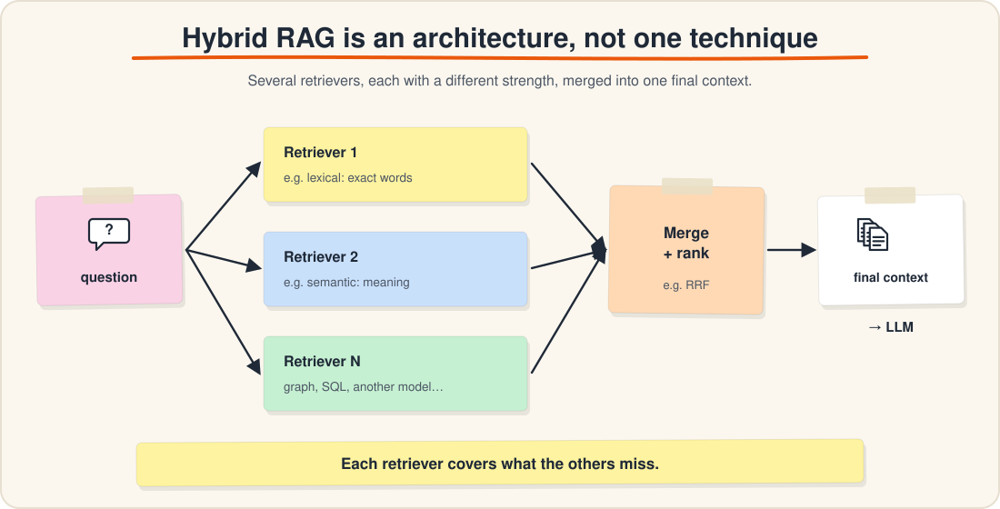
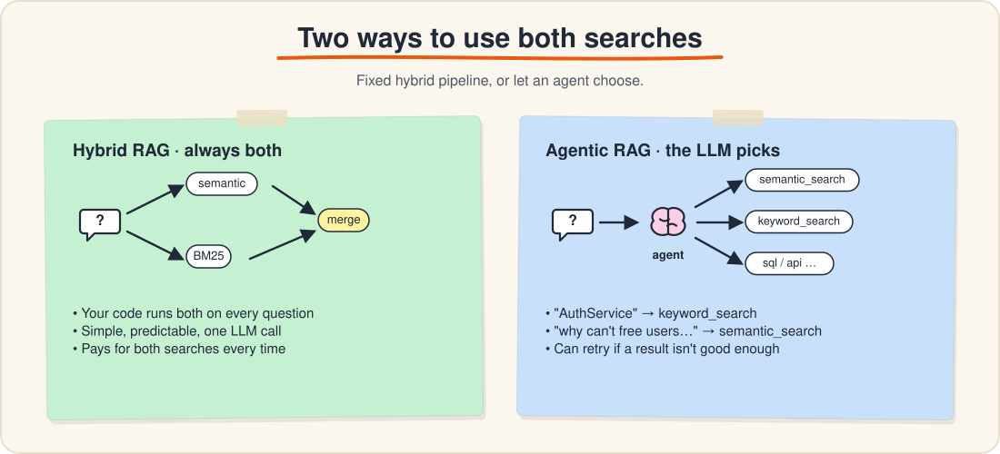

# 10. Hybrid RAG

> ⏱ 15 min · Prerequisites: [Semantic vs. lexical search](09-semantic-vs-lexical.md) · [← Semantic vs. lexical](09-semantic-vs-lexical.md) · [Learning path](README.md) · Code: [module 04](../../../modules/04-hybridrag/README.md)

## In one sentence

**Hybrid RAG is not one specific retrieval technique: it's a retrieval _architecture_ that
runs several retrieval strategies and merges their results into one final context.**

## Why do we need it?

Every retriever has blind spots. Semantic search misses exact names; lexical search misses
synonyms ([previous page](09-semantic-vs-lexical.md)). Instead of choosing one and living with
its blind spots, Hybrid RAG uses several, so each one covers what the others miss.

## How it works



1. **Combine results from multiple retrieval strategies.** The same question goes to every retriever.
2. **Each retriever contributes different strengths.** One finds exact words, another finds
   meaning, another finds relationships or numbers.
3. **Merge and rank.** The separate result lists are merged into one ranked list, and the top
   results become the **final context** for the LLM.

## What can you combine?

Hybrid retrieval can combine **any** retrieval approaches:


| Combination | What each part adds | Example question |
|---|---|---|
| **Lexical + Semantic** | Exact names + meaning | "Why does `check_task_limit` block free users?" |
| **Semantic + Graph** | Meaning + relationships between things | "Which services call `AuthService`?" |
| **Semantic + SQL** | Meaning + exact numbers and filters | "How many tasks does each plan tier allow, and why?" |
| **Several vector retrievers** (different embedding models) | Different "views" of meaning, e.g. a text model + a code model | Code questions asked in plain English |

> 📌 **Lexical + semantic is by far the most common pairing.** Many search tools (Elasticsearch,
> OpenSearch, most vector databases) use the name **"hybrid search"** for exactly this pair.
> It's what module 04 builds.

## The most common one: lexical + semantic (module 04)


Module 04 reuses what you already built:
- the **semantic** retriever from module 01 (MiniLM embeddings + Chroma, top 4)
- the **lexical** retriever from module 03 (your tokenizer + BM25, top 4)
- LangChain's `EnsembleRetriever` to **merge** them

## How are the results merged?

### Why not just add the scores?

They're on **different scales**. A BM25 score might be `4.73`, while a vector distance might be
`0.62`, and for distance *lower* is better. Adding them is like adding kilometres to kilograms.

### Reciprocal Rank Fusion (RRF)

RRF ignores the scores and uses only each chunk's **rank** (1st, 2nd, 3rd…) in each list:

```
 points for a chunk  =  Σ over lists:   weight  /  (60 + rank in that list)
```

60 is a standard constant (also `EnsembleRetriever`'s default) that stops one list's #1 from
dominating everything.

With **equal weights** (0.5 / 0.5), from the diagram above:

| Chunk | Semantic rank | Lexical rank | Final |
|---|---|---|---|
| A | 1 | 2 | **#1** (good in both) |
| C | 3 | 1 | **#2** (good in both) |
| B | 2 | (not found) | #3 |
| D | (not found) | 3 | #4 |

**Chunks that rank well in both lists rise to the top.**

### Weights: tilt the merge toward one retriever

`--weights SEMANTIC LEXICAL` changes how much each list counts. Running `EnsembleRetriever`
on two small lists (semantic: A, B, C, E; lexical: C, A, D, F):

| Weights (semantic, lexical) | Merged order | What changed |
|---|---|---|
| 0.5, 0.5 | A, C, B, D, E, F | Balanced |
| 0.7, 0.3 | A, C, B, **E**, D, F | Semantic-only E moves above lexical-only D |
| 0.3, 0.7 | **C**, A, D, F, B, E | Lexical's #1 (C) becomes overall #1 |

```
 Questions with exact names / error messages   →  favour lexical   (0.3 0.7)
 Questions in everyday words                    →  favour semantic  (0.7 0.3)
 Mixed or unknown                               →  equal            (0.5 0.5)
```

> ⚠️ **`EnsembleRetriever` returns every unique chunk from both lists**, not just the top 4.
> With 4 + 4 results, the agent can get up to **8 chunks** per search (fewer when both lists
> find the same chunk). More context, but also more tokens.

## Hybrid vs. agentic: who decides?

There are two ways to use several retrievers:



| | Hybrid RAG | Agentic RAG (routing) |
|---|---|---|
| Who picks the retriever? | **Your code**: always all of them | **The LLM**: one tool per need |
| Searches per question | Always all | 1 or more, as the LLM decides |
| Predictable? | ✅ Yes | ⚠️ Less |
| Can retry? | ❌ No | ✅ If a result isn't good enough, it searches again |
| Start with… | ✅ This one: simpler to build and test | Once you have tools and evals |

They also **combine**: module 04's agent calls **one** tool, and that tool is a hybrid retriever.
The agent decides *when* to search; the hybrid retriever decides *how*.

> 🔁 Agents can loop: when a result isn't good enough, the LLM searches again. Module 04 adds
> **guardrails** for that: at most 5 LLM calls and 2 searches per question.

## Common beginner mistakes

| Mistake | Reality |
|---|---|
| "Hybrid RAG is a specific algorithm" | It's an architecture: *several retrievers + a merge step*. Which retrievers is up to you. |
| "Just add BM25 and vector scores together" | Different scales. Merge by rank (RRF). |
| "More retrievers is always better" | Each one adds cost, latency and noise. Add one only if it covers a real blind spot. |
| "Hybrid returns k chunks" | `EnsembleRetriever` returns all unique chunks from every list (up to 8 in module 04). |
| "Hybrid fixes bad chunks" | It still depends on good chunking and a sensible `k`. Measure it with the test cases. |

## Check yourself

<details>
<summary>1. In one sentence, what is Hybrid RAG?</summary>

A retrieval architecture that runs several retrieval strategies and merges their results into
one ranked final context, so each covers the others' blind spots.
</details>

<details>
<summary>2. Name two hybrid combinations other than lexical + semantic.</summary>

Any two of: semantic + graph, semantic + SQL, several vector retrievers with different embedding models.
</details>

<details>
<summary>3. Chunk X is #1 in semantic search but not found by BM25. Chunk Y is #2 in both. With equal weights, which wins?</summary>

Y: 0.5/62 + 0.5/62 ≈ 0.0161, while X gets only 0.5/61 ≈ 0.0082. Being good in both lists beats
being best in one.
</details>

<details>
<summary>4. Most of your users paste error messages. Which weights would you try first?</summary>

Favour lexical, e.g. `--weights 0.3 0.7`, because error messages are exact text. Then check with
your test cases.
</details>

<details>
<summary>5. What's the difference between hybrid RAG and agentic routing?</summary>

Hybrid: your code always runs all retrievers and merges them. Agentic routing: the LLM picks which
retriever (tool) to call for each question, and can call again if the result isn't good enough.
</details>

---

[← Semantic vs. lexical](09-semantic-vs-lexical.md) · [Back to learning path](README.md) · Code: [module 04](../../../modules/04-hybridrag/README.md) · Next: [Agentic AI →](../02-agentic-ai/README.md)
