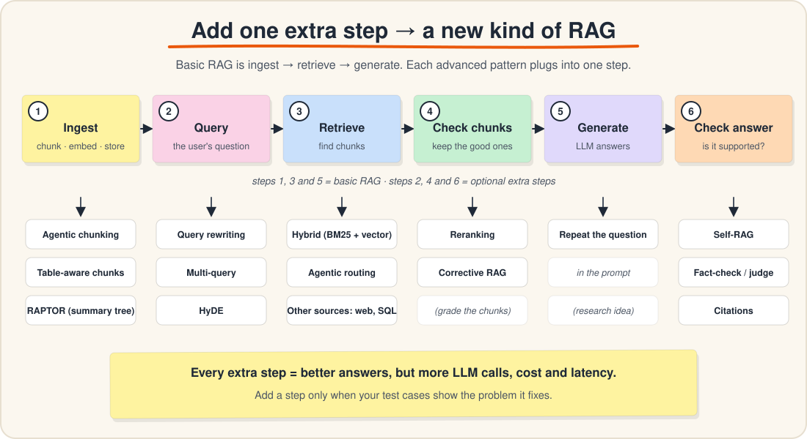
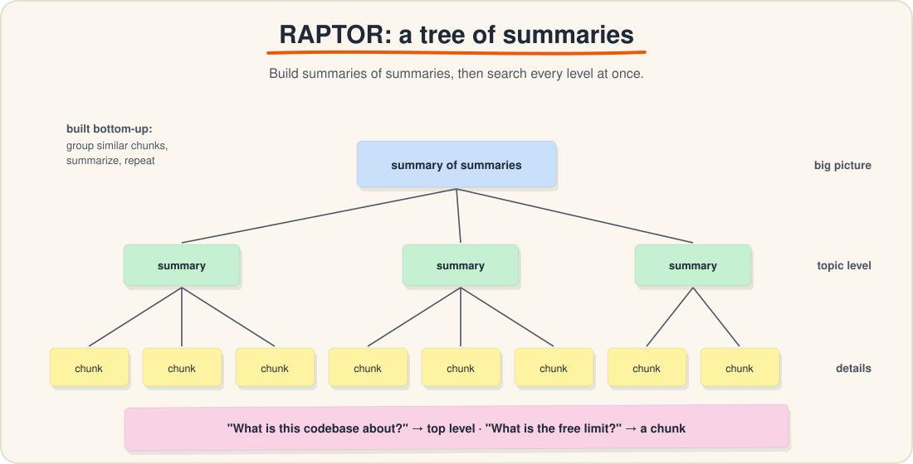
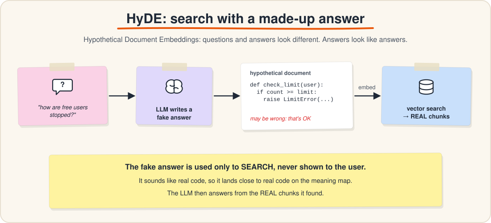
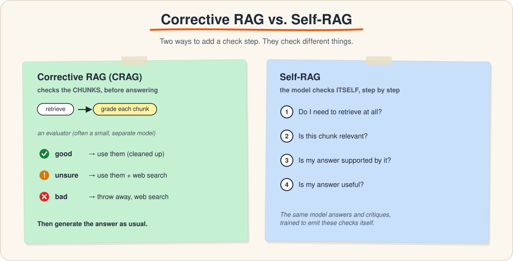
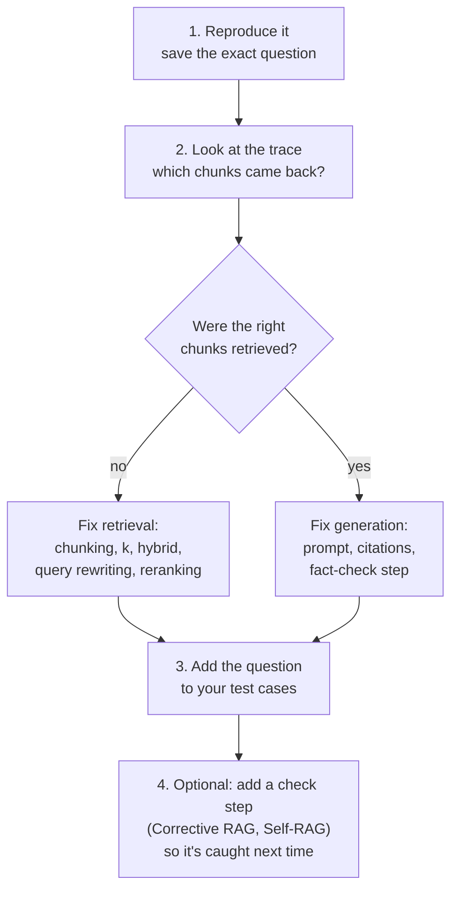

# 11. Advanced RAG patterns

> ⏱ 20 min · Prerequisites: [Testing a RAG system](06-evaluating-rag.md), [Hybrid RAG](10-hybrid-rag.md) · [← Hybrid RAG](10-hybrid-rag.md) · [Learning path](README.md)

## In one sentence

**Most "new kinds of RAG" are basic RAG plus one extra step, added where basic RAG goes wrong.**

## Why do we need them?

Basic RAG has three steps: **ingest** (chunk, embed, store), **retrieve**, **generate**. Each
step can fail:
- the chunks are badly cut
- the question is worded differently from the documents
- the wrong chunks come back
- the LLM ignores or misreads the chunks

Advanced patterns fix one of these failures by adding a step. But every extra step means more
LLM calls, **more cost and more latency**, so add one only when your test cases show the
problem it fixes.

## The map: where each pattern plugs in



| Step | Fixes this problem | Patterns |
|---|---|---|
| 1. Ingest | Chunks are cut badly, or lose the big picture | Table-aware chunking, agentic chunking, RAPTOR |
| 2. Query | The question is worded differently from the documents | Query rewriting, multi-query, HyDE |
| 3. Retrieve | One search method has blind spots | Hybrid, agentic routing, other sources ([page 10](10-hybrid-rag.md)) |
| 4. Check chunks | Irrelevant chunks reach the LLM | Reranking, Corrective RAG |
| 5. Generate | The LLM misses parts of the question | Repeat the question in the prompt (research idea) |
| 6. Check answer | The answer isn't supported by the chunks | Self-RAG, fact-check / LLM judge, citations |

## Step 1 · Ingest: better chunks

| Pattern | Idea | Good for |
|---|---|---|
| **Split + overlap** (what we use) | Cut by size, share some text at the borders | Most text ([page 2](02-chunking.md)) |
| **AST chunking** | Cut code at whole classes / functions | Code ([page 7](07-chunking-code-with-ast.md)) |
| **Table-aware chunking** | Repeat the table's **header row** in every chunk | Tables: a row like `10 \| 200` is meaningless without its headers |
| **Agentic chunking** | An **LLM** reads the text and decides where topics start and end | Messy documents without clear structure (costs one LLM call per document) |
| **RAPTOR** | Build a **tree of summaries** above the chunks | Big-picture questions |

### RAPTOR: a tree of summaries



Basic RAG only has small chunks, so a question like *"What is this codebase about?"* matches
no single chunk well. RAPTOR groups similar chunks, writes a summary of each group, then
summarizes those summaries, and so on. All levels go into the index together:
- **Big-picture questions** match the summaries.
- **Detail questions** still match the original chunks.

*Cost:* many LLM calls to build the tree (once, at ingest time). The main gain is **better
answers to broad questions**, not speed.

## Step 2 · Query: better questions

Users often ask short, vague or differently worded questions. Transform the question
**before** searching:

| Pattern | What happens | Example |
|---|---|---|
| **Query rewriting** | The LLM rewrites the question into a better search query | "stop users making too many tasks" → "task limit check billing" |
| **Multi-query** | The LLM writes **several** versions; search with each and merge the results | 3 phrasings → 3 searches → more chances to hit |
| **HyDE** | The LLM writes a **fake answer**; search with *that* instead of the question | See below |

> 💡 Our agents already rewrite queries: `2_eval_rag.py` shows the agent's own search words
> ([Agentic RAG](../02-agentic-ai/03-agentic-rag.md)).

### HyDE: Hypothetical Document Embeddings



A question ("how are free users stopped?") and the code that answers it look very different.
A *made-up answer* looks much more like the real code, so its embedding lands closer to the
right chunks. The made-up answer **may contain mistakes, and that's fine**: it's only used to
search, and the LLM answers from the real chunks it finds.

## Step 3 · Retrieve: better search

Covered on the previous pages:
- **Hybrid**: several retrievers, merged ([page 10](10-hybrid-rag.md)).
- **Agentic routing**: the LLM picks a retriever per question.
- **Other sources**: the same pipeline can retrieve from more than a vector DB:

| Source | Retrieved with | Example |
|---|---|---|
| Vector DB (Chroma, Qdrant…) | Semantic search | Our modules 01, 02 |
| Inverted index (Elasticsearch…) | BM25 | Our module 03 |
| SQL / MongoDB | Queries (often LLM-written) | "Tasks per plan tier" |
| Graph DB | Graph queries | "Who calls `AuthService`?" |
| Web | Web search API | Fresh information |
| Files | grep / file reads | Coding agents |

## Step 4 · Check the chunks before answering

### Reranking

Search is fast but rough. A **reranker** is a second, more careful model that reads the
question **and** each chunk *together*, and re-sorts them:

```
 retrieve top 20 (fast, rough)  →  reranker re-sorts them (slow, careful)  →  keep the best 5
```

It works after **any** retriever (vector, BM25 or hybrid). It isn't part of BM25 itself.

### Corrective RAG (CRAG)

An evaluator **grades the retrieved chunks** before the LLM sees them. If they're good, use
them. If they're bad, throw them away and fetch other information (typically a **web search**).
If unsure, use both.

## Step 5 · A research idea: say the question twice

Research such as *"Re-Reading Improves Reasoning in Large Language Models"* (RE2) found that
repeating the question in the prompt (*"Read the question again: …"*) can help some models
understand it better:

```
 normal:    [ context ] + [ question ]                  → LLM
 repeated:  [ context ] + [ question ] + [ question ]   → LLM
```

It's cheap to try (a few extra tokens), but results vary by model. **Measure it with your test
cases before relying on it.**

## Step 6 · Check the answer



| | Corrective RAG | Self-RAG | Fact-check step |
|---|---|---|---|
| Checks | The **chunks** | Chunks **and** its own answer | The **answer** |
| When | Before generating | While generating | After generating |
| Who checks | An evaluator (often a small separate model) | The **same** model, trained to critique itself | Another LLM call ("LLM as judge"), same or different model |
| If it fails | Web search for better information | Retrieve again or rewrite | Retry, or answer "I don't know" |

**Citations** are the simplest check of all: ask the LLM to quote the file and line for every
claim. Unsupported claims are then easy to spot, for you and for an automatic checker.

## "Users say the answers are wrong. What would you do?"

A classic interview question. Don't jump straight to a fancy pattern; **find the failing step first**:



This is the [two failure points](06-evaluating-rag.md#a-rag-system-can-fail-in-two-places) from page 6, used for debugging.

## Common beginner mistakes

| Mistake | Reality |
|---|---|
| "Corrective RAG = a different model checks, Self-RAG = the same model checks" | Close, but the real difference is **what** is checked: CRAG grades the **retrieved chunks** (and can fall back to web search); Self-RAG has the model decide when to retrieve and critique its **own answer**. |
| "HyDE = querying more times" | Querying several times is **multi-query**. HyDE searches with a **made-up answer** instead of the question. |
| "Reranking is part of BM25" | It's a separate step after any retriever: re-sort the top results with a more careful model. |
| "RAPTOR makes RAG faster" | Its main gain is **better answers to broad questions**. Building the tree costs many LLM calls. |
| "More steps = better RAG" | Each step adds cost and latency, and can add its own errors. Add steps your test cases prove you need. |

## Check yourself

<details>
<summary>1. Users' questions are short and vague, and retrieval keeps missing. Which step would you improve, and with what?</summary>

Step 2 (query): query rewriting, multi-query or HyDE, so the search uses better words than the raw question.
</details>

<details>
<summary>2. In HyDE, what happens if the made-up answer contains a mistake?</summary>

Usually nothing bad: it's only used to search. The final answer comes from the real chunks that
search finds.
</details>

<details>
<summary>3. What's the main difference between Corrective RAG and Self-RAG?</summary>

CRAG grades the retrieved chunks before answering and can fetch other information (e.g. web
search) if they're bad. Self-RAG has the model itself decide when to retrieve and critique
whether its own answer is supported and useful.
</details>

<details>
<summary>4. Why retrieve 20 chunks and rerank down to 5, instead of retrieving 5 directly?</summary>

Fast search is rough; the right chunk may be #12. The reranker reads each chunk with the
question and is more accurate, but too slow to run on everything, so it only re-sorts the top 20.
</details>

<details>
<summary>5. "What is this whole codebase about?" Why does basic RAG struggle, and which pattern helps?</summary>

No single small chunk describes the whole codebase. RAPTOR adds summaries (and summaries of
summaries), which match big-picture questions.
</details>

---

[← Hybrid RAG](10-hybrid-rag.md) · [Back to learning path](README.md) · [Next: Evaluation metrics →](12-why-evaluation-metrics.md)
