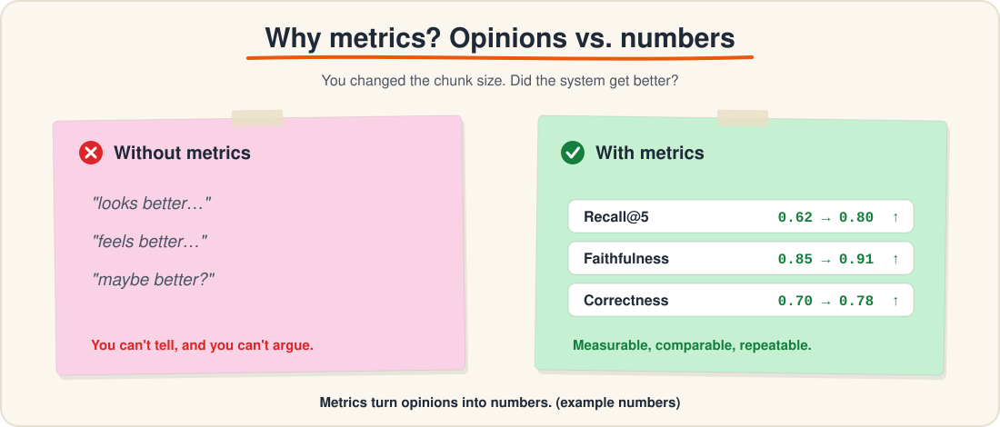
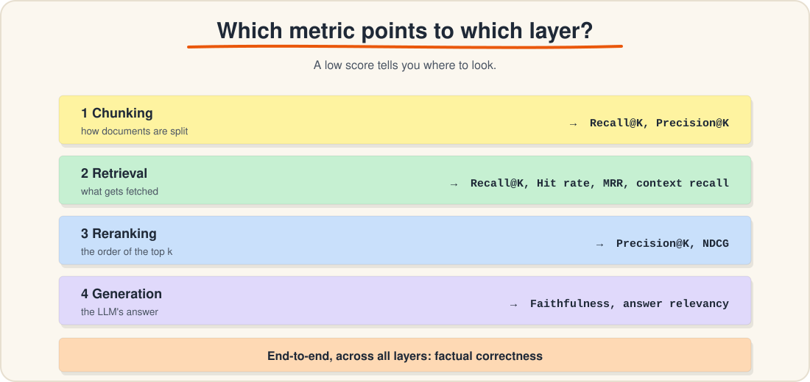

# 12. Evaluation metrics: why and what

> ⏱ 10 min · Prerequisites: [Testing a RAG system](06-evaluating-rag.md) · [← Advanced RAG patterns](11-advanced-rag-patterns.md) · [Learning path](README.md) · [Next: The golden dataset →](13-golden-dataset.md)

## In one sentence

**Metrics turn "it looks better" into numbers, and measuring each part separately tells you
_which_ part to fix.**

## Why do we need metrics?

A question passes through several parts before an answer comes out:

```
 Question → Retriever → Chunks → LLM → Answer
```

Now you change something: the embedding model, the chunk size, the overlap, `k`, the
retriever, a reranker, the prompt, or the LLM itself. **Did the system get better?**



| Without metrics | With metrics |
|---|---|
| "Looks better" | Recall@5: 0.62 → 0.80 |
| "Feels better" | Faithfulness: 0.85 → 0.91 |
| "Maybe better?" | Correctness: 0.70 → 0.78 |
| Two people disagree, nobody can prove it | Everyone sees the same numbers |

> 💡 You already did this by hand in module 01: tick the facts, count file hits and chunk
> hits. Metrics are the same idea, made automatic and comparable.

## Measure each part, so you know where it broke

A bad answer can come from **anywhere**:
- the retriever missed the right chunk
- the chunks were too small
- a reranker pushed the best chunk down
- the LLM made something up

If you only look at the final answer, you can only guess which. So we measure at **three levels**:


| Level | Question it answers | Example metrics | Page |
|---|---|---|---|
| 1. Retrieval | Did we retrieve the right chunks? | Recall@K, Precision@K, Hit rate, MRR, NDCG | [14](14-retrieval-metrics.md) |
| 2. Generation | Did the LLM write a good answer from them? | Faithfulness, Answer relevancy | [15](15-generation-metrics.md) |
| 3. End-to-end | Did the user get the correct result? | Factual correctness | [15](15-generation-metrics.md) |

## A low score points to a layer



| If this is low… | …look at this first |
|---|---|
| Recall@K | Retrieval or chunking: the right chunks aren't coming back |
| Precision@K | Too much noise: `k` too big, chunks too big, or no reranker |
| MRR / NDCG | Ranking: the right chunks come back, but too far down |
| Faithfulness | Generation: the LLM adds things that aren't in the chunks |
| Answer relevancy | Generation: the LLM answers a different question |
| Correctness, but all the above are fine | The golden answer itself, or a question type you never tested |

## Common beginner mistakes

| Mistake | Reality |
|---|---|
| "I'll just read a few answers" | Fine for a first look, but you can't compare 10 versions by eye, and you'll miss regressions. |
| "One overall score is enough" | It tells you *that* something broke, not *where*. Measure each layer. |
| "Metrics first, test questions later" | Metrics need known right answers to compare against. That's the [golden dataset](13-golden-dataset.md), next page. |

## Check yourself

<details>
<summary>1. You switched the embedding model. The answers "feel" better. What's missing?</summary>

Numbers. Run the same test questions before and after and compare metrics such as Recall@K and
faithfulness; otherwise it's just an opinion.
</details>

<details>
<summary>2. Recall@5 is high, but faithfulness is low. Which part do you fix?</summary>

Generation. The right chunks are being retrieved, but the LLM adds things that aren't in them:
improve the prompt or add a fact-check step.
</details>

<details>
<summary>3. Name the three levels of RAG evaluation.</summary>

Retrieval (right chunks?), generation (good answer from the chunks?), end-to-end (correct result
for the user?).
</details>

---

[← Advanced RAG patterns](11-advanced-rag-patterns.md) · [Back to learning path](README.md) · [Next: The golden dataset →](13-golden-dataset.md)
