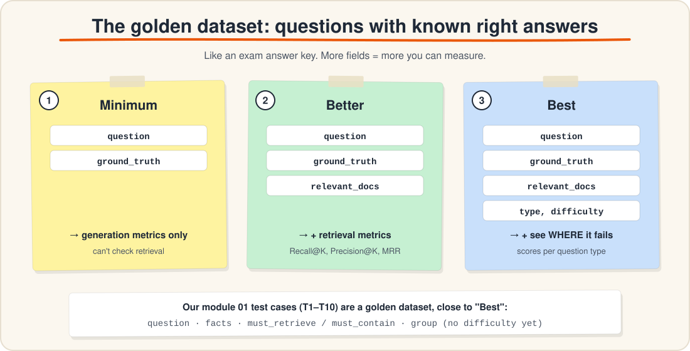
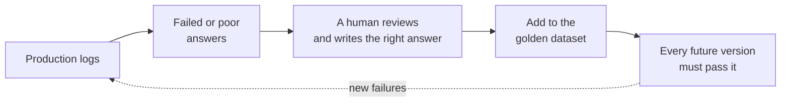

# 13. The golden dataset

> ⏱ 15 min · Prerequisites: [Evaluation metrics: why and what](12-why-evaluation-metrics.md) · [← Why metrics](12-why-evaluation-metrics.md) · [Learning path](README.md) · [Next: Retrieval metrics →](14-retrieval-metrics.md)

## In one sentence

**A golden dataset is a list of real questions with manually checked right answers (and the
right chunks): the answer key that every metric compares against.**

## Why do we need it?

Most people jump straight to metrics: Recall@K, faithfulness, RAGAS. But a metric is a
**comparison**, and you can't compare against nothing:

```
 Without golden dataset                 With golden dataset
 ──────────────────────                 ───────────────────
 Question → RAG → Answer                Question → RAG → Answer
                    │                                      │
                    ▼                                      ▼
          "Looks good to me" 🤷            compared with the KNOWN right answer
                                           → Recall@5 = 0.85, Faithfulness = 0.91
```

Think of a school exam. Without an **answer key**, the teacher can only say "looks fine".
The golden dataset is your RAG system's answer key.

## What's in it?

Each example is one question with its known truth:

```json
{
  "question":      "What is the task limit for a free plan user?",
  "ground_truth":  "10 tasks (Pro: 200, Enterprise: 10,000).",
  "relevant_docs": ["billing.py: TASK_LIMITS"],
  "type":          "factoid",
  "difficulty":    "easy"
}
```

That's test **T1** from module 01, written in this format. The more fields you fill, the more
you can measure:



| Level | Fields | What you can measure |
|---|---|---|
| **Minimum** | question + ground truth | Generation only (faithfulness, answer relevancy). **Not** retrieval. |
| **Better** | + relevant docs | Also retrieval: Recall@K, Precision@K, MRR |
| **Best** | + type, difficulty, other metadata | Scores **per question type**, so you see exactly where it fails |

> 💡 **You already have one.** Module 01's [test cases](../../../modules/01-rag/test_cases.md)
> have a question, the facts a good answer needs (ground truth), the files and lines that hold
> the answer (relevant docs), and a group (type). Only "difficulty" is missing.

## Which questions to include

A dataset of only easy questions gives **falsely high scores**. Cover different types:

| Type | Example | What it tests | In our T1–T10? |
|---|---|---|---|
| **Factoid** | "What is the free plan limit?" | Simple lookup in one chunk | ✅ T1, T2, T3 |
| **Multi-hop** | "Do scheduled tasks send notifications?" | Combining facts from several chunks or files | ✅ T7, T8 |
| **Procedural** | "Walk me through creating a task" | Steps, in the right order | ✅ T5, T6 |
| **Summarization** | "Summarize how permissions work" | Pulling together many chunks | ❌ missing |
| **Comparison** | "Compare the free and pro plans" | Very common in real company RAG | ❌ missing |
| **Ambiguous** | "Tell me about limits" | Finding the right section from a vague question | ❌ missing |
| **Trap / not in data** | "How does Stripe payment work?" | Saying "not found" instead of inventing | ✅ T9, T10 |

✍️ **Exercise:** add one summarization, one comparison and one ambiguous question to your test cases.

## How teams create golden datasets

| Approach | How | Good | Bad |
|---|---|---|---|
| **1. Human-written** | Experts write questions, answers and relevant docs | Most accurate | Slow and expensive |
| **2. From production logs** | Take real user questions and label them by hand | Matches what users *really* ask | Needs a live system first |
| **3. Synthetic** | An LLM writes questions and answers from your documents (tools like RAGAS do this) | Fast and cheap | Lower quality: **a human must review it** |

Mature teams mix all three, with production logs as the main source.

## How many examples?

| Stage | Rough size |
|---|---|
| Proof of concept | 50–100 |
| Good dataset | 300–1,000 |
| Enterprise grade | 5,000+ |

These are rough guides, not rules. **Quality beats quantity:** 100 well-chosen, varied
questions are worth more than 10,000 easy factoid questions.

## Why metrics are impossible without it

Retrieval metrics need to know **which chunks are the right ones**:

```
 Question:            "Who founded Netflix?"
 Right docs (golden): doc_12, doc_17
 Retriever returned:  doc_17, doc_88, doc_91

 Recall@3    = found 1 of the 2 right docs        = 1/2 = 0.50
 Precision@3 = 1 of the 3 returned docs is right  = 1/3 = 0.33
```

Without knowing that `doc_12` and `doc_17` are the right ones, you can't compute either number.

## It grows over time: like unit tests

The golden dataset isn't written once. Every real failure becomes a new test:



> 🔑 **The most important idea:** a golden dataset is less about measuring today's system and
> more about **catching regressions**: things that get worse after a change. It plays the same
> role as unit tests in software. Every time you change embeddings, chunking, reranking,
> prompts or models, it answers: *did we improve, or did we break something?*

## Common beginner mistakes

| Mistake | Reality |
|---|---|
| "Let the LLM write all the questions and answers" | Fine as a start, but unreviewed synthetic data has mistakes. A human must check it. |
| "Only easy questions" | Scores look great and mean little. Include multi-hop, comparison, ambiguous and trap questions. |
| "Write it once" | Keep adding real failures, like adding a unit test for every bug you fix. |
| "Question + answer is enough" | Without the relevant docs you can't measure retrieval at all. |

## Check yourself

<details>
<summary>1. Your dataset has only question + ground truth. Can you compute Recall@5?</summary>

No. Recall needs to know which chunks are the right ones (`relevant_docs`). You can only measure
generation metrics.
</details>

<details>
<summary>2. Your system scores 95%, but every test question is a simple lookup. Should you trust it?</summary>

No. Easy-only datasets give falsely high scores. Add multi-hop, summarization, comparison,
ambiguous and trap questions.
</details>

<details>
<summary>3. A user reports a wrong answer. What should happen to that question?</summary>

Write the correct answer (and relevant docs), add it to the golden dataset, and make sure future
versions pass it, just like adding a unit test for a bug.
</details>

---

[← Why metrics](12-why-evaluation-metrics.md) · [Back to learning path](README.md) · [Next: Retrieval metrics →](14-retrieval-metrics.md)
