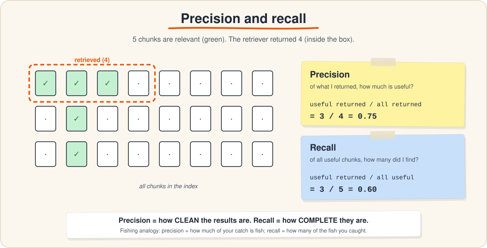
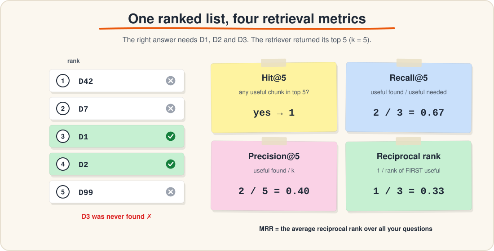
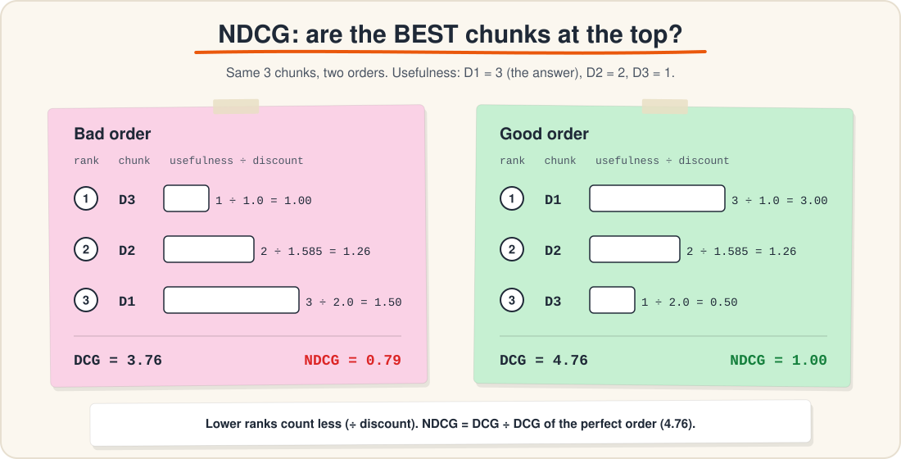

# 14. Retrieval metrics

> ⏱ 25 min · Prerequisites: [The golden dataset](13-golden-dataset.md), [Chunk size and k](04-chunk-size-and-k.md) · [← The golden dataset](13-golden-dataset.md) · [Learning path](README.md) · [Next: Generation metrics →](15-generation-metrics.md)

## In one sentence

**Retrieval metrics compare the chunks your retriever returned with the chunks your golden
dataset says are right: how clean the results are, how complete, and how high up the good ones are.**

## The two basic questions

Imagine a search engine. There are 1,000 documents: **100 are relevant**, 900 aren't. You
search and get 20 back. Two questions:

| Question | Metric |
|---|---|
| Of what I got back, how much is **garbage**? | **Precision** |
| Of all the useful documents, how many did I **find**? | **Recall** |

## Precision and recall



```
 Precision = useful chunks returned ÷ all chunks returned      → how CLEAN
 Recall    = useful chunks returned ÷ all useful chunks        → how COMPLETE
```

| | High | Low |
|---|---|---|
| **Precision** | Little noise | Lots of garbage returned |
| **Recall** | Few useful chunks missed | Many useful chunks missed |

**When recall matters most:** medical or legal search (missing one document can be a disaster),
and **RAG in general**: if the retriever misses a fact, the LLM *cannot* use it.

## The tradeoff

You can cheat either metric, but not both:

```
 1,000 documents, 100 relevant

 System A: return ALL 1,000        System B: return just 1 (it's relevant)
 Recall    = 100/100  = 1.00 ✅     Precision = 1/1    = 1.00 ✅
 Precision = 100/1000 = 0.10 ❌     Recall    = 1/100  = 0.01 ❌
 "found everything, 90% garbage"   "no garbage, missed 99%"
```

Raising one usually lowers the other. That's why you always look at **both**.

| Only looking at… | What it hides | RAG example |
|---|---|---|
| **Recall** | The noise | All 3 right chunks found, but among 8 returned: recall 1.0, precision 0.375. The LLM wades through 5 useless chunks. |
| **Precision** | The gaps | Only 1 chunk returned and it's right: precision 1.0, recall 0.33. The LLM lacks 2 needed facts. |

## Why "@K"?

Classic recall imagines searching the whole collection. RAG never does: it only passes the
**top K** chunks to the LLM (`k` in our code), because the prompt has limited room. So we
measure only inside the top K: **Recall@K** and **Precision@K**.

## Four metrics on one ranked list



| Metric | Question it answers | Formula | Above |
|---|---|---|---|
| **Hit@K** (hit rate) | Did we get *any* useful chunk? | 1 if yes, 0 if no | 1 |
| **Recall@K** | How much of the needed info is in the top K? | useful in top K ÷ all useful | 2/3 = 0.67 |
| **Precision@K** | How much of the top K is noise? | useful in top K ÷ K | 2/5 = 0.40 |
| **Reciprocal rank** | How far down is the *first* useful chunk? | 1 ÷ its rank | 1/3 = 0.33 |

📌 **How they move with K:**
- **Recall@K can only stay the same or go up** as K grows: more chunks, more chances.
- **Precision@K usually goes down** as K grows: lower-ranked chunks are usually worse
  (e.g. Precision@3 = 0.9 but Precision@20 = 0.3).

That's the [chunk size and k](04-chunk-size-and-k.md) tradeoff again, now with numbers.

### Why hit rate isn't enough

```
 System A: useful chunk at rank 1    → Hit = 1
 System B: useful chunk at rank 20   → Hit = 1      same score, but A is clearly better
```

Hit rate ignores **position**. Position matters because the LLM uses the top chunks most, and
because a chunk at rank 20 is cut off if you lower `k`. That's why we need ranking metrics.

> 📝 LLMs tend to use information at the **start** (and end) of a long prompt best, and
> overlook the middle (the "lost in the middle" effect). Putting the best chunks first helps.

## MRR: how quickly do we find the first useful chunk?

**Rank** is just the position in the returned list (1 = first). For one question, the
**reciprocal rank** is `1 ÷ rank of the first useful chunk`:

| First useful chunk at rank | Reciprocal rank |
|---|---|
| 1 | 1/1 = **1.00** (perfect) |
| 2 | 1/2 = 0.50 |
| 5 | 1/5 = 0.20 |
| 10 | 1/10 = 0.10 |
| not found | 0 |

**MRR (Mean Reciprocal Rank)** is the average over all your questions:

```
 Question 1: first useful at rank 1 → 1.00
 Question 2: first useful at rank 3 → 0.33
 Question 3: first useful at rank 2 → 0.50

 MRR = (1.00 + 0.33 + 0.50) ÷ 3 = 0.61
```

MRR only looks at the **first** useful chunk and ignores everything after it.

## NDCG: are the *best* chunks at the top?

The metrics so far treat chunks as simply useful or not. But some chunks are **more useful**
than others. NDCG uses a usefulness score per chunk (from the golden dataset):

| Chunk | Usefulness | Meaning |
|---|---|---|
| D1 | 3 | The exact answer |
| D2 | 2 | A supporting fact |
| D3 | 1 | Weakly related |
| D4 | 0 | Irrelevant |

Return all three in a bad order and Recall@3 still says 1.0 (perfect). NDCG doesn't:



In four small steps:

1. **Gain** = each chunk's usefulness score.
2. **Discount**: divide the gain by `log₂(rank + 1)`, so lower ranks count less:
   rank 1 ÷ 1.0, rank 2 ÷ 1.585, rank 3 ÷ 2.0, rank 5 ÷ 2.585.
3. **DCG** (Discounted Cumulative Gain) = add them up. Bad order: 3.76. Good order: 4.76.
4. **NDCG** = DCG ÷ the DCG of the *perfect* order (4.76). Bad: 3.76 ÷ 4.76 = **0.79**. Good: **1.00**.

So NDCG is always between 0 and 1, and 1.0 means "best chunks first".

### MRR vs. NDCG

| | MRR | NDCG |
|---|---|---|
| Looks at | Only the **first** useful chunk | The **whole** ranking |
| Usefulness | Yes/no | Graded (0, 1, 2, 3…) |
| Use when | One good chunk is enough to answer | Judging a **reranker**, or chunks differ in usefulness |
| Needs | Which chunks are relevant | A usefulness **score** per chunk (more work to label) |

## Real numbers: module 03 (BM25) on our golden dataset

I ran module 03's BM25 search (character chunks of 256, k = 5, your exact question as the
search) on T1–T9. A "useful chunk" is one that contains a line from `must_contain`.

| Test | Hit@5 | Recall@5 | Precision@5 | Reciprocal rank |
|---|---|---|---|---|
| T1 free plan limit | 0 | 0.00 | 0.00 | 0 |
| T2 default role | 1 | 1.00 | 0.20 | 0.33 (rank 3) |
| T3 viewer actions | 1 | 1.00 | 0.20 | 0.25 (rank 4) |
| T4a check_task_limit | 1 | 1.00 | 0.20 | 0.20 (rank 5) |
| T4b plain English | 0 | 0.00 | 0.00 | 0 |
| T5 create flow | 1 | 0.33 | 0.20 | 0.25 (rank 4) |
| T6 scheduler tick | 0 | 0.00 | 0.00 | 0 |
| T7 cross-file | 0 | 0.00 | 0.00 | 0 |
| T8 retry on limit | 1 | 0.50 | 0.20 | 0.50 (rank 2) |
| T9 bcrypt trap | 1 | 1.00 | 0.20 | 0.50 (rank 2) |
| **Average** | **0.60** | **0.48** | **0.12** | **MRR 0.20** |

What the numbers tell us:
- **Hit 0.60:** for 4 of 10 questions, *nothing* useful came back, so the LLM can't answer those.
- **MRR 0.20:** even when found, the useful chunk sits around rank 3–5. A reranker could help.
- **Precision 0.12 looks terrible, but isn't the real problem.** Most questions have only **one**
  useful chunk, so with k = 5 the best possible Precision@5 is 1/5 = 0.20. Always ask what the
  *maximum* possible score is.
- **T4b fails** with BM25 (plain English, no shared words), exactly what semantic search is for.
  This is how you'd *prove* hybrid search helps: run the same table for module 04 and compare.

✍️ **Exercise:** add Hit@K, Recall@K and MRR to `2_eval_rag.py` so you get this table for every run.

## Cheat sheet

| Metric | Measures | Needs an LLM? | Needs the golden dataset? |
|---|---|---|---|
| Hit@K | Any success at all? | No | Yes |
| Recall@K | Missing chunks in the top K | No | Yes |
| Precision@K | Noise in the top K | No | Yes |
| MRR | How high the first useful chunk is | No | Yes |
| NDCG | Overall order, with graded usefulness | No | Yes, with scores |

None of these need an LLM: they're simple counting. That makes them **fast and free** to run
after every change.

## Common beginner mistakes

| Mistake | Reality |
|---|---|
| "Recall 1.0, so retrieval is perfect" | Check precision too: you may be flooding the LLM with noise. |
| "Precision 0.2 is a disaster" | If only 1 chunk is relevant and k = 5, 0.2 is the maximum. Compare to the best possible score. |
| "Hit rate is enough" | It ignores position: rank 1 and rank 20 score the same. |
| "MRR and NDCG are the same thing" | MRR: only the first useful chunk, yes/no. NDCG: the whole order, graded usefulness. |
| "Bigger K always helps" | Recall goes up, precision usually goes down, and the prompt gets longer and costlier. |

## Check yourself

<details>
<summary>1. Right chunks: D1, D2. Retrieved top 4: D5, D1, D9, D7. Compute Recall@4, Precision@4 and the reciprocal rank.</summary>

Recall@4 = 1/2 = 0.50. Precision@4 = 1/4 = 0.25. Reciprocal rank = 1/2 = 0.50 (first useful chunk, D1, is at rank 2).
</details>

<details>
<summary>2. A system returns 1 chunk, and it's right. Precision 1.0. Is that good for RAG?</summary>

Not necessarily. If 3 chunks are needed, recall is only 0.33: the LLM is missing information.
</details>

<details>
<summary>3. Two systems both have hit rate 1.0. How could you tell which is better?</summary>

Use a ranking metric such as MRR or NDCG. The one that puts the useful chunk higher is better.
</details>

<details>
<summary>4. You add a reranker. Which metric should improve, and which shouldn't change?</summary>

NDCG and MRR should improve (better order). Recall depends on the setup: if the reranker only
re-orders the same K chunks, Recall@K can't change. If it re-sorts a *bigger* list and keeps the
best K (e.g. retrieve 20, keep 5), Recall@5 can go up too, because good chunks from ranks 6–20
move into the top 5.
</details>

---

[← The golden dataset](13-golden-dataset.md) · [Back to learning path](README.md) · [Next: Generation metrics →](15-generation-metrics.md)
