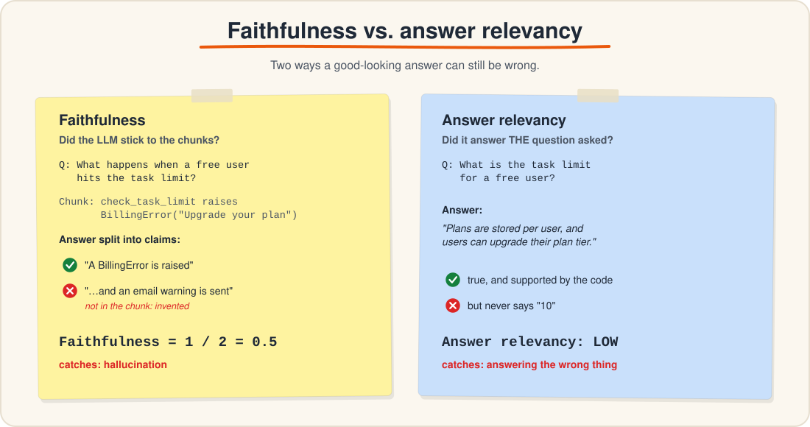

# 15. Generation and end-to-end metrics

> ⏱ 15 min · Prerequisites: [Retrieval metrics](14-retrieval-metrics.md) · [← Retrieval metrics](14-retrieval-metrics.md) · [Learning path](README.md)

## In one sentence

**Generation metrics check the LLM's answer: did it stick to the chunks (faithfulness), did it
answer the actual question (answer relevancy), and was it right (correctness)?**

## Why do we need them?

Retrieval can be perfect and the answer can still be wrong. The LLM might:
- **add facts** from its training data that aren't in the chunks (hallucination)
- **answer a different question** than the one asked

Retrieval metrics can't catch either, because they only look at *what was retrieved*, not
*what the LLM said*.



## Faithfulness: did the LLM stick to the chunks?

Faithfulness checks that **every claim in the answer is supported by the retrieved chunks**.

**How it's scored** (by an LLM acting as a judge):
1. Split the answer into separate factual **claims**.
2. For each claim, ask the judge: *"Is this supported by the retrieved chunks? Yes / No"*.
3. Score = supported claims ÷ all claims.

```
 Chunk:   check_task_limit raises BillingError("…Upgrade your plan_tier…")
 Answer:  "A BillingError is raised, and an email warning is sent."

 Claim 1: "A BillingError is raised"        ✓ in the chunk
 Claim 2: "an email warning is sent"         ✗ not in the chunk: invented

 Faithfulness = 1 ÷ 2 = 0.5
```

| High faithfulness | Low faithfulness |
|---|---|
| The answer stays inside the chunks | The LLM is adding facts from its own memory |

**If it's low:**
- Tell the LLM clearly: *"Use only the provided context. If it isn't there, say you don't know."*
  (Our system prompt already has a version of this.)
- Ask for citations (file and line) for every claim.
- Add a check step after generating ([Advanced RAG patterns](11-advanced-rag-patterns.md)).
- Lowering the temperature can help a little, but it's not a fix on its own.

> ⚠️ Faithfulness doesn't check whether the answer is *true*, only whether it's *supported by the
> chunks*. If the chunks are wrong, a faithful answer is wrong too.

## Answer relevancy: did it answer *the* question?

An answer can be faithful **and** true, and still miss the point:

```
 Question: "What is the task limit for a free user?"
 Answer:   "Plans are stored per user, and users can upgrade their plan tier."

 ✓ faithful (it's all in the code)
 ✗ never says "10"
```

**How it's scored** (works backwards):
1. Give the judge LLM only the **answer**, and ask: *"What question is this answering?"*
   Repeat a few times.
2. Measure how similar those questions are to the **original** question (using embeddings).
3. Similar → the answer is on topic. Different → it drifted.

```
 Generated from the answer:  "How are plans stored?"   "Can users upgrade?"
 Original question:          "What is the task limit for a free user?"
                             → not very similar → low answer relevancy
```

**If it's low:** tell the LLM to answer the specific question asked, check that the chunks even
contain the answer (a retrieval problem in disguise), or show it a few examples of short, direct answers.

## Faithfulness vs. answer relevancy

| | Faithfulness | Answer relevancy |
|---|---|---|
| Question | Did it stick to the chunks? | Did it answer the question asked? |
| Catches | **Hallucination**: facts added beyond the chunks | **Drift**: answering the wrong thing |
| Compares the answer with | The retrieved chunks | The question |
| Needs the golden answer? | No | No |

## End-to-end: was the answer correct?

**Factual correctness** compares the answer with the **ground truth** from your golden dataset.
It's what the user cares about in the end:

```
 Golden answer:  "10 tasks"
 System answer:  "Free users can create up to 10 tasks."   → correct ✓
```

You did this by hand in module 01, by ticking the `facts` boxes. An LLM judge can do the same
automatically.

## Two more you'll meet: context precision and context recall

Tools like **RAGAS** also offer LLM-judged versions of the retrieval metrics. They compare the
retrieved chunks against the golden *answer* instead of a list of relevant chunk IDs:

| Metric | Question |
|---|---|
| **Context precision** | Are the retrieved chunks actually useful for this question (and the useful ones ranked first)? |
| **Context recall** | Do the retrieved chunks contain all the facts the golden answer needs? |

They're handy when you have golden *answers* but never labelled which *chunks* are relevant.

## The full cheat sheet

| Metric | Measures | Needs an LLM judge? | Needs the golden dataset? | Layer |
|---|---|---|---|---|
| Hit@K | Any success at all? | No | Yes | Retrieval |
| Recall@K | Missing chunks in the top K | No | Yes | Chunking / retrieval |
| Precision@K | Noise in the top K | No | Yes | Retrieval / reranking |
| MRR | Position of the first useful chunk | No | Yes | Retrieval |
| NDCG | Overall order, graded | No | Yes (with scores) | Reranking |
| Context precision | Are retrieved chunks useful? | Yes | Yes (golden answer) | Retrieval |
| Context recall | Do chunks cover the needed facts? | Yes | Yes (golden answer) | Retrieval |
| **Faithfulness** | Answer stays within the chunks? | Yes | No | Generation |
| **Answer relevancy** | Answer addresses the question? | Yes | No | Generation |
| **Factual correctness** | Answer matches the golden answer? | Yes | Yes | End-to-end |

```
 Counting metrics (no LLM):  fast, free, exact          → run after every change
 LLM-judge metrics:          slower, cost money, can be  → run on important changes,
                             wrong themselves               and spot-check the judge
```

## Common beginner mistakes

| Mistake | Reality |
|---|---|
| "Faithful = correct" | Faithful only means *supported by the chunks*. Wrong chunks → faithful but wrong answer. |
| "Correct = relevant" | A true statement that doesn't answer the question has low answer relevancy. |
| "The LLM judge is always right" | Judges make mistakes too. Check a sample of their verdicts by hand. |
| "Only measure the final answer" | Then you know *that* it failed, not *where*. Measure retrieval and generation separately. |

## Check yourself

<details>
<summary>1. The answer has 4 claims; 3 are in the chunks, 1 comes from the LLM's memory. Faithfulness?</summary>

3 ÷ 4 = 0.75. The fourth claim is unsupported, even if it happens to be true.
</details>

<details>
<summary>2. Question: "How do I log out?" Answer: "Sessions are stored in a dictionary." Faithful? Relevant?</summary>

It can be faithful (that's what the code does), but answer relevancy is low: it doesn't say how
to log out (call `logout(token)`).
</details>

<details>
<summary>3. Faithfulness is 1.0, but factual correctness is low. What's probably wrong?</summary>

Retrieval. The LLM faithfully repeated the chunks it got, but they were the wrong chunks (or the
golden answer is wrong). Check Recall@K.
</details>

<details>
<summary>4. Which metrics can you run for free after every change, without an LLM?</summary>

The counting metrics: Hit@K, Recall@K, Precision@K, MRR and NDCG (with a golden dataset).
</details>

---

[← Retrieval metrics](14-retrieval-metrics.md) · [Back to learning path](README.md) · Next: [Agentic AI →](../02-agentic-ai/README.md)
