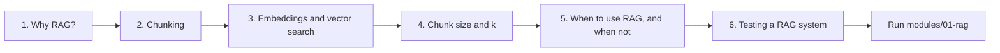
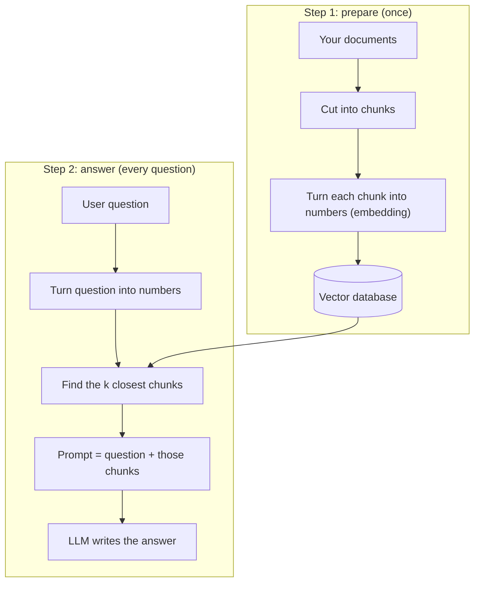

# RAG: learning path

> **New here? Read the pages in this order.** Each page builds on the one before.
> You don't need to understand everything the first time. Run the code, then come back.
> It gets clearer every time.

| # | Page | You will learn | Time |
|---|---|---|---|
| 1 | [Why RAG?](01-why-rag.md) | The problem RAG solves. With vs. without RAG. | 10 min |
| 2 | [Chunking](02-chunking.md) | Why documents are cut into pieces, and how. | 10 min |
| 3 | [Embeddings and vector search](03-embeddings.md) | How text becomes numbers, and how "search by meaning" works. | 15 min |
| 4 | [Chunk size and k](04-chunk-size-and-k.md) | The two main knobs. What happens in each combination. How to choose. | 15 min |
| 5 | [When to use RAG](05-when-to-use-rag.md) | When RAG is the right tool, when it isn't, and real use cases. | 15 min |
| 6 | [Testing a RAG system](06-evaluating-rag.md) | How to prove a change made things better, not just different. | 10 min |

## The whole idea on one page

**R**etrieval (find the right pieces) → **A**ugmented (add them to the prompt) → **G**eneration (the LLM answers).

## Where this appears in the code

| Concept | File | Function |
|---|---|---|
| Load documents | [1_semantic_rag.py](../../../modules/01-rag/1_semantic_rag.py) | `load_codebase()` |
| Chunking | same | `chunk_code()` |
| Embeddings + vector DB | same | `build_vector_store()` |
| Retrieval with top-k | same | `build_agent()` → `as_retriever(search_kwargs={"k": k})` |
| Testing | [2_eval_rag.py](../../../modules/01-rag/2_eval_rag.py) | `run_test()` |

## Self-check before moving on

After all six pages, you should be able to answer these without looking.
Each page has its own questions at the bottom, with answers.

- [ ] Why can't the LLM just answer questions about my private documents?
- [ ] Why do we cut documents into chunks instead of embedding the whole file?
- [ ] What is an embedding, in one sentence?
- [ ] What happens when chunks are small **and** k is small?
- [ ] Give two situations where RAG is the **wrong** tool.
- [ ] Why can a good-looking answer still hide bad retrieval?

Words you don't know → [glossary](../../glossary.md).
