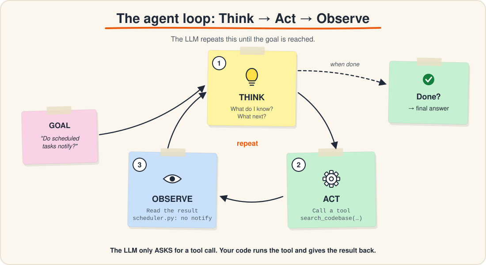
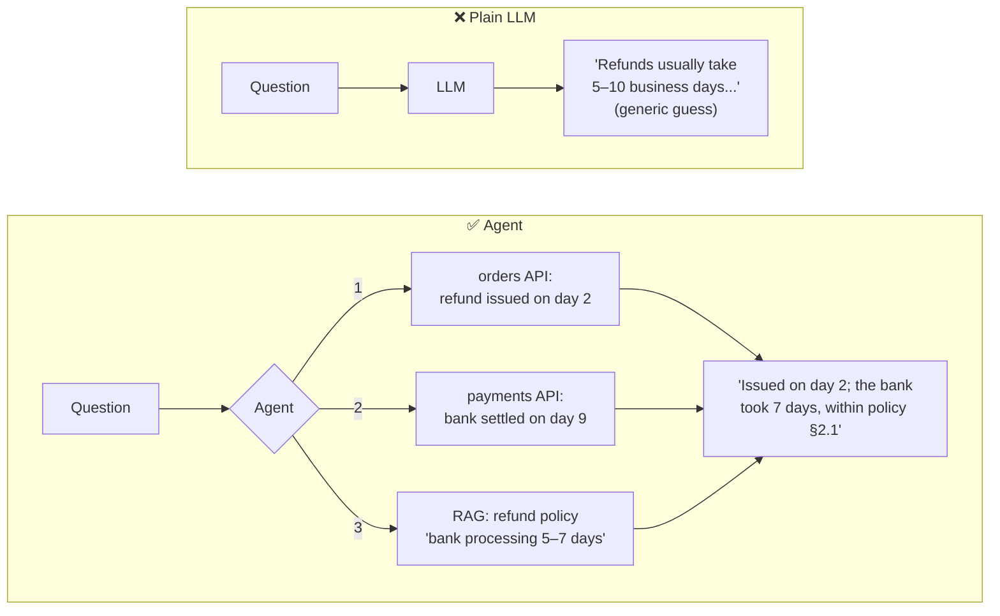

# 1. What is an agent?

> ⏱ 15 min · Prerequisites: [RAG module](../01-rag/README.md) helps, but isn't required · [← Learning path](README.md) · [Next: Building blocks →](02-building-blocks.md)

## In one sentence

**An agent is an LLM that works in a loop: it decides on an action, uses a tool, looks at the
result, and repeats until the goal is reached.**

## Three levels: LLM call → workflow → agent

```
 Level 1: LLM call          Level 2: Workflow (chain)       Level 3: Agent
 ─────────────────          ─────────────────────────       ──────────────
 question                   step 1 ─► step 2 ─► step 3      goal
    │                       (YOU wrote the steps            ┌─► think ─┐
    ▼                        in code; always the             │          ▼
   LLM                       same order)                    observe ◄─ act (tool)
    │                                                        └── until done ──┘
    ▼                                                       (the LLM DECIDES the steps)
 answer
```

| | LLM call | Workflow | Agent |
|---|---|---|---|
| Who decides the steps? | Nobody (one step) | **You**, in code | **The LLM**, at run time |
| Can use tools? | ❌ | ✅ Fixed ones, fixed order | ✅ Picks which, when, how often |
| Predictable? | ✅ Very | ✅ Very | ⚠️ Less |
| Cost and speed | 💰 Cheapest, fastest | 💰💰 | 💰💰💰 Most calls, slowest |
| Handles unexpected situations | ❌ | ❌ Only paths you coded | ✅ Can adapt |
| Example | "Translate this text" | "Fetch email → summarize → post to Slack" | "Find out why the build is failing and fix it" |

> 💡 More autonomy isn't automatically better. **Use the lowest level that does the job.**
> See [when NOT to use agents](04-use-cases.md#-when-not-to-use-an-agent).

## The agent loop (ReAct)

The most common pattern is called **ReAct**: **Re**ason + **Act**.



### A real example: our own RAG agent

**Question:** "Do tasks created by the scheduler send notifications?" (test T7)

```
 THINK    I need to know how the scheduler creates tasks.
 ACT      search_codebase("scheduler creates task")
 OBSERVE  scheduler.py: tick() calls self.db.create_task(...) directly.

 THINK    Does TaskService send notifications? Does the scheduler use it?
 ACT      search_codebase("TaskService notifications on task created")
 OBSERVE  task_service.py: create_task() calls notifications.on_task_created().
          scheduler.py: __init__(db, billing, audit): no NotificationService.

 THINK    The scheduler bypasses TaskService, so no notifications. I'm done.
 ANSWER   "No. TaskScheduler calls db.create_task directly (scheduler.py, tick)..."
```

The LLM decided **on its own** to search twice, with search words **it** chose.
`2_eval_rag.py` shows these searches in its output under **Searches**.

## With vs. without an agent

**Task:** "Why did customer #881's refund take 9 days?"



| | Plain LLM | Agent |
|---|---|---|
| Looks at real data | ❌ | ✅ Order, payment and policy |
| Answer | Generic guess | Specific, with evidence |
| Calls | 1 | 4–5 (more cost, more time) |

## What makes something "agentic"?

```
 ✅ It decides WHAT to do next          (not a fixed script)
 ✅ It uses TOOLS to act on the world    (search, APIs, code, files)
 ✅ It LOOPS, using results to decide    (observe → think again)
 ✅ It works toward a GOAL               (not just "reply to this message")
```

A chatbot that only replies from its training data is **not** an agent, however smart it is.

## Common beginner mistakes

| Mistake | Reality |
|---|---|
| "Agents are a different kind of model" | Same LLM. "Agent" is the **loop + tools** around it. |
| "The agent runs the tools itself" | The LLM only **asks** for a tool call (name + arguments). **Your code** runs it and sends back the result. |
| "Agents are always better" | Slower, costlier, less predictable. A fixed workflow is better when the steps are known. |
| "The agent remembers everything" | Only what's in its current messages, unless you add memory ([page 2](02-building-blocks.md)). |

## Check yourself

<details>
<summary>1. "Every morning, fetch yesterday's sales, summarize them, email the team." Agent or workflow?</summary>

Workflow. The steps are always the same and known in advance. An agent would add cost and
unpredictability for no benefit.
</details>

<details>
<summary>2. What are the three steps of the ReAct loop?</summary>

Think (reason about what to do next) → Act (call a tool) → Observe (read the result). Repeat until done.
</details>

<details>
<summary>3. Who actually executes a tool: the LLM or your code?</summary>

Your code. The LLM outputs "call search_codebase with query X"; the framework runs the function
and passes the result back to the LLM as a new message.
</details>

---

[← Learning path](README.md) · [Next: Building blocks →](02-building-blocks.md)
