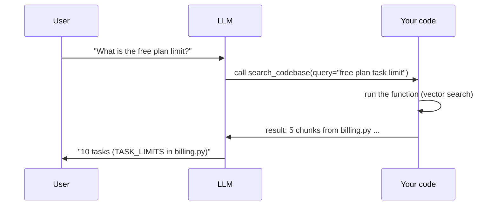

# 2. Building blocks of an agent

> ⏱ 15 min · Prerequisites: [What is an agent?](01-what-is-an-agent.md) · [← Learning path](README.md) · [Next: Agentic RAG →](03-agentic-rag.md)

## In one sentence

**An agent = a model + instructions + tools + memory, running in a loop, with guardrails
around it.**


## 1. Model 🧠: the brain

The LLM that does the thinking. It reads everything in the conversation and decides the next step.

| | Stronger model | Smaller model |
|---|---|---|
| Multi-step reasoning | ✅ Better | ⚠️ Gets lost on long tasks |
| Cost and speed | 💰💰💰 Slower | 💰 Faster |
| Good for | Planning, hard decisions | Simple, repeated steps |

Our module uses `gpt-4o-mini`: cheap and good enough for simple searches.

## 2. Instructions 📜: the job description

The **system prompt** tells the agent who it is, what to do, and what not to do. From
`1_semantic_rag.py`:

```
 "You are a senior engineer.                                  ← role
  Always use search_codebase before answering.               ← how to work
  Reference specific file and function names.                ← output format
  If not found say 'I could not find that in the codebase'." ← what to do when stuck
```

That last line is what test **T10** (Stripe) checks. Without it, the agent is much more likely
to invent an answer.

## 3. Tools 🛠️: the hands

A **tool** is a normal function the agent is allowed to call. The LLM sees each tool's
**name**, **description** and **arguments**, and decides when to use it.



> 💡 **The description matters a lot.** The LLM picks tools by reading their descriptions.
> A vague description ("does stuff with code") means the tool gets used at the wrong times, or never.

Common tool types:

| Tool type | Example |
|---|---|
| Search / retrieval | `search_codebase`, web search, RAG over docs |
| APIs | Get order status, create a ticket, send an email |
| Code execution | Run Python, run tests |
| Files | Read, write, grep |
| Databases | Run a SQL query |
| Other agents | "Ask the research agent" (multi-agent) |

## 4. Memory 🗂️

```
 Short-term memory                     Long-term memory
 ─────────────────                     ────────────────
 The current conversation:             Facts kept between sessions:
 messages, tool calls, results.        "user is vegetarian", "prefers Python".

 Lives in the prompt.                  Stored outside (database / vector DB),
 Lost when the session ends.           retrieved when relevant (that's RAG!).
 Limited by the context window.
```

## 5. Planning 🗺️

For bigger goals, the agent first breaks the goal into steps:

```
 Goal: "Write a report comparing our 3 competitors' pricing"

 Plan:  1. Search pricing page of competitor A
        2. Search pricing page of competitor B
        3. Search pricing page of competitor C
        4. Put the numbers in a table
        5. Write the summary
```

Simple agents (like ours) plan implicitly, one step at a time. Advanced agents write an
explicit plan first, then follow and revise it.

## 6. Guardrails 🛡️: the safety rails

An agent takes **actions**, so mistakes have real effects. Guardrails limit the damage:

| Guardrail | Example |
|---|---|
| Max steps / budget | Stop after 10 tool calls |
| Human approval | Ask before sending an email or deleting data |
| Allowed tools only | A support agent can read orders but not issue refunds over $100 |
| Input / output checks | Block personal data from appearing in answers |
| Logging / tracing | Record every step (e.g. LangSmith, already in `.env.example`) |

## How the pieces map to our code

| Building block | In `1_semantic_rag.py` |
|---|---|
| Model | `ChatOpenAI(model="gpt-4o-mini", temperature=0)` |
| Instructions | `system_prompt="You are a senior engineer..."` |
| Tools | `create_retriever_tool(... name="search_codebase")` |
| Loop | `create_agent(llm, tools=[...])` runs think → act → observe for you |
| Short-term memory | `{"messages": [...]}`: the messages passed in |
| Long-term memory | ❌ none yet (each question starts fresh) |
| Guardrails | The "say not found" rule (very basic) |

## Check yourself

<details>
<summary>1. Your agent never calls a tool you gave it. What's the first thing to check?</summary>

The tool's **description** (and name). The LLM decides from the description; if it doesn't clearly
say when the tool is useful, the LLM won't pick it.
</details>

<details>
<summary>2. Our agent forgets the previous question. Why?</summary>

Each question is sent with a fresh `messages` list, so there's no short-term memory across
questions, and there's no long-term memory either.
</details>

<details>
<summary>3. Give one guardrail you'd add before letting an agent send emails to customers.</summary>

Human approval before sending, or limits on recipients and content checks (for example, block
personal data).
</details>

---

[← What is an agent?](01-what-is-an-agent.md) · [Next: Agentic RAG →](03-agentic-rag.md)
