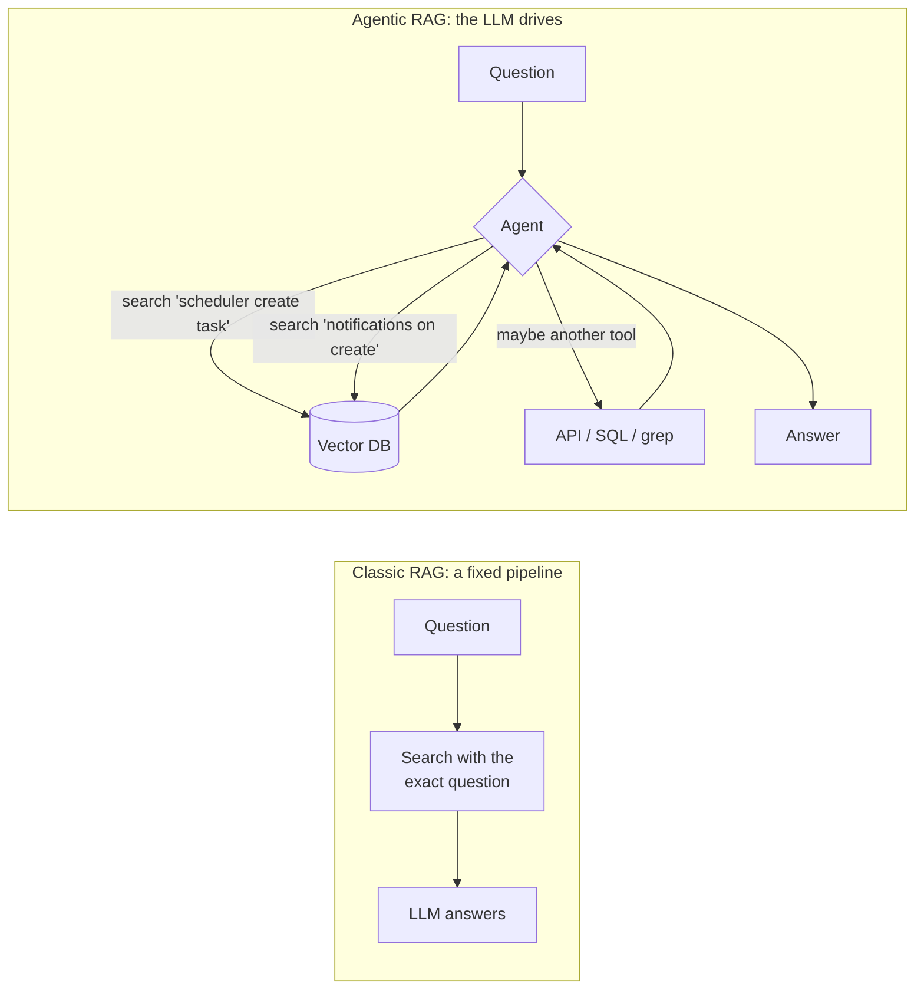

# 3. Agentic RAG

> ⏱ 10 min · Prerequisites: [RAG learning path](../01-rag/README.md), [Building blocks](02-building-blocks.md) · [← Learning path](README.md) · [Next: Use cases →](04-use-cases.md)

## In one sentence

**In classic RAG, your code always searches once with the user's exact question; in agentic RAG,
the LLM decides whether to search, what to search for, and how many times.**

## Classic RAG vs. agentic RAG



| | Classic RAG | Agentic RAG |
|---|---|---|
| Searches | Always exactly 1 | 0, 1 or many: the LLM decides |
| Search words | The user's exact question | The LLM **rewrites** them |
| Other tools | ❌ | ✅ Can mix RAG with APIs, SQL, grep |
| Cross-file / multi-part questions | ⚠️ Weak | ✅ Searches each part |
| Cost / speed | 💰 One LLM call | 💰💰 Several LLM calls |
| Predictability | ✅ High | ⚠️ Lower |

## You already built both!

`2_eval_rag.py` runs the **same** questions both ways:

```
 --retrieval-only  ─►  CLASSIC: searches with your exact question, once
 (default)         ─►  AGENTIC: create_agent + search_codebase tool
                       the output lists the agent's own searches, for example:

   **Searches (2):**
   1. `scheduler task creation`                 ← rewritten by the LLM
   2. `TaskService create_task notifications`   ← a second search it chose
```

## Why rewriting the query helps

```
 User question:   "How does the app stop users from creating too many tasks?"   (T4b)
                   long, chatty, no code words

 Agent's search:  "task limit check billing"
                   short, focused, closer to the words in the code
```

The agent turns a conversational question into a **better search query**. Compare T4b in
retrieval-only mode vs. agent mode to see the effect yourself.

## When agentic RAG goes wrong

| Problem | Why | Fix |
|---|---|---|
| Doesn't search at all, answers from memory | LLM thinks it already knows | Prompt: "Always use search_codebase before answering" (we have this) |
| Searches 8 times for a simple question | No limits | Max-steps guardrail |
| Invents a Stripe flow (T10) | Retriever always returns k chunks; LLM over-trusts them | Prompt rule: say "not found" when the chunks don't contain it |
| Repeats the misleading word (T9: bcrypt) | The comment mentions bcrypt | Ask for evidence: "quote the exact line" |

## Check yourself

<details>
<summary>1. What are the two main things the agent adds on top of classic RAG?</summary>

It decides **whether and how many times** to search, and it **rewrites** the search query.
It can also combine search with other tools.
</details>

<details>
<summary>2. T4b scores badly in --retrieval-only mode but well in agent mode. Why?</summary>

In agent mode, the LLM rewrites the chatty question into a short, code-like search query that
matches the chunks better. Retrieval-only searches with the exact question.
</details>

---

[← Building blocks](02-building-blocks.md) · [Next: Use cases →](04-use-cases.md)
