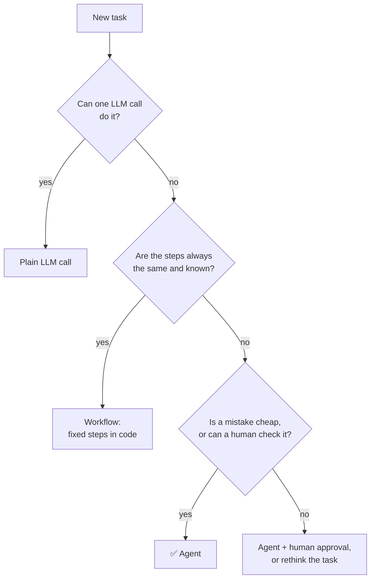

# 4. Agentic AI use cases, and when not to use agents

> ⏱ 15 min · Prerequisites: [What is an agent?](01-what-is-an-agent.md) · [← Learning path](README.md)

## In one sentence

**Use an agent when the steps can't be known in advance and the task needs several tools;
use a fixed workflow when they can.**

## Quick test: does this task need an agent?



## Use cases

### 1. Coding agent
```
 "Fix the failing test" ─► read error ─► grep ─► open file ─► edit ─► run tests ─┐
                              ▲                                                    │
                              └──────────── still failing? try again ◄────────────┘
```
**Why an agent:** you can't know in advance which files to open. Each test result decides the next step.
**Tools:** grep, read/write files, run commands. *Examples: Claude Code, Copilot agent mode.*

### 2. Customer support agent
```
 "Where's my order and can I change the address?"
        ├─► orders API: shipped, in transit
        ├─► RAG: "address changes allowed before delivery, via courier"
        └─► courier API: change address ──(needs approval?)──► reply to customer
```
**Why an agent:** each customer asks a different mix of things.
**Guardrail:** human approval for refunds over a limit.

### 3. Research assistant
```
 "Compare 3 vector databases for our use case"
   plan ─► web search × 6 ─► read docs ─► build comparison table ─► write report with sources
```
**Why an agent:** it has to decide what to search next based on what it found.

### 4. Data analyst agent
```
 "Why did sales drop in March?"
   SQL: sales by region ─► "North dropped 30%" ─► SQL: North by product ─► "Product X"
   ─► RAG: release notes ─► "Product X price change on Mar 3" ─► chart + explanation
```
**Why an agent:** each answer raises the next question. That's a drill-down nobody can script in advance.
**Note:** numbers come from **SQL**, not RAG. RAG only finds the release note.

### 5. IT operations / on-call agent
```
 Alert: "API latency high"
   metrics tool ─► logs search ─► RAG over past postmortems ─► "same as incident #212"
   ─► suggest fix ─► (human approves) ─► run restart
```
**Why an agent:** investigation paths differ for every incident.

### 6. Personal assistant
```
 "Book a meeting with Priya next week and send her the agenda doc"
   calendar: free slots ─► email: propose time ─► drive: find agenda ─► send
```

### 7. Multi-agent systems
```
                 ┌─► Researcher agent ─┐
 Goal ─► Planner ┼─► Coder agent ──────┼─► Reviewer agent ─► Result
                 └─► Writer agent ─────┘
```
Several specialised agents, each with its own instructions and tools, coordinated by one planner.
Powerful, but harder to debug. Start with one agent.

### Use cases at a glance

| Use case | Main tools | Why not a fixed workflow? | Key guardrail |
|---|---|---|---|
| Coding | grep, files, terminal | Unknown which files matter | Run tests; human reviews the change |
| Customer support | Order API, RAG, ticketing | Every request is different | Approval for refunds |
| Research | Web search, RAG | Next search depends on findings | Cite sources |
| Data analysis | SQL, charts, RAG | Drill-down path unknown | Read-only DB access |
| On-call / IT ops | Metrics, logs, runbooks | Each incident differs | Approval before changes |
| Personal assistant | Calendar, email, docs | Many small varied steps | Confirm before sending |

## ❌ When NOT to use an agent

| Situation | Better choice | Why |
|---|---|---|
| Steps are always the same | **Workflow** | Cheaper, faster, predictable, easy to test |
| One LLM call does it ("summarize this") | **Plain LLM call** | Nothing to decide |
| Must be correct 100% of the time (payments, legal filings) | **Normal code** + LLM for small parts | Agents can make surprising choices |
| Very low latency needed (< 1 second) | **Single call or cached answer** | Each loop step adds seconds |
| Tight budget, huge volume | **Workflow / smaller model** | Agents make many LLM calls per task |
| Mistakes are expensive and nobody reviews | **Human in the loop**, or don't automate | Actions have real effects |

```
 Rule of thumb:
   Start with the SIMPLEST thing that works  →  LLM call
   Add structure when needed                 →  workflow
   Add autonomy only when the steps are truly unknown  →  agent
```

## Check yourself

<details>
<summary>1. "Translate every new support ticket to English and tag its language." Agent?</summary>

No. Same steps every time, so it's a workflow (or a single LLM call per ticket).
</details>

<details>
<summary>2. Why is the data analyst agent a good fit for an agent but a bad fit for RAG alone?</summary>

Agent: the drill-down path depends on each result. RAG alone: it can't calculate totals or trends;
those numbers must come from SQL.
</details>

<details>
<summary>3. Name a guardrail for an agent that can restart production servers.</summary>

Human approval before any restart (and/or allow restarts only for specific services, with logging).
</details>

---

[← Agentic RAG](03-agentic-rag.md) · [Back to learning path](README.md)
