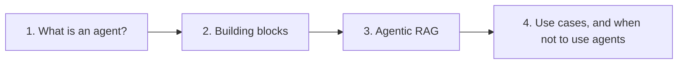

# Agentic AI: learning path

> **Read in order.** Page 3 connects agents back to the RAG module you've already built.



| # | Page | You will learn | Time |
|---|---|---|---|
| 1 | [What is an agent?](01-what-is-an-agent.md) | LLM call vs. workflow vs. agent. The agent loop. With vs. without. | 15 min |
| 2 | [Building blocks](02-building-blocks.md) | Model, instructions, tools, memory, planning, guardrails. | 15 min |
| 3 | [Agentic RAG](03-agentic-rag.md) | Classic RAG vs. agentic RAG, explained with our own code. | 10 min |
| 4 | [Use cases](04-use-cases.md) | Real agent use cases, and when a simple workflow is better. | 15 min |

## The whole idea on one page

```
 Plain LLM:   question ─► LLM ─► answer                         (one shot, no actions)

 Agent:       goal ─► ┌──────────────────────────────┐
                      │  THINK  what should I do next?│
                      │    │                          │
                      │    ▼                          │
                      │  ACT    call a tool           │ ◄── repeats until done
                      │    │                          │
                      │    ▼                          │
                      │  OBSERVE read the result      │
                      └──────────────┬───────────────┘
                                     ▼
                                  answer / task done
```

**An agent is an LLM in a loop that decides which actions (tools) to take, and when, to reach a goal.**

## Self-check before moving on

- [ ] What's the difference between a workflow and an agent?
- [ ] Name the three steps of the agent loop.
- [ ] What is a "tool", and how does the agent know when to use it?
- [ ] How is agentic RAG different from classic RAG?
- [ ] Give one task where an agent is a **bad** idea.
