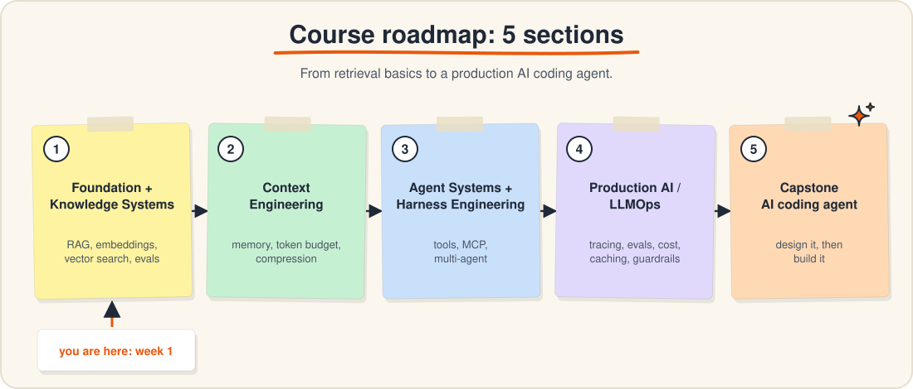

# Course roadmap

The course has 5 sections. This page tracks each topic and links to where it's covered in this repo.

**Status:** ✅ covered · 🟡 partly covered · ⚪ not started

> Update the status as you go. When a topic gets its own page or module, link it here.

## 1. Foundation + Knowledge Systems (week 1, current)

| Topic | Status | Where |
|---|---|---|
| Retrieval fundamentals: embeddings, chunking, vector search | ✅ | [Chunking](concepts/01-rag/02-chunking.md), [Embeddings](concepts/01-rag/03-embeddings.md), [Chunk size and k](concepts/01-rag/04-chunk-size-and-k.md), [AST chunking](concepts/01-rag/07-chunking-code-with-ast.md), [module 01](../modules/01-rag/README.md), [module 02](../modules/02-semanticrag-with-ast/README.md) |
| Lexical, semantic and hybrid retrieval | ✅ | [Lexical search and BM25](concepts/01-rag/08-lexical-search-and-bm25.md), [Hybrid RAG](concepts/01-rag/09-hybrid-rag.md), [module 03](../modules/03-lexicalrag/README.md) (hybrid not coded yet) |
| Vector databases, ANN, FAISS, HNSW | ⚪ | |
| Production RAG architecture | ⚪ | |
| Advanced RAG patterns | 🟡 | [Agentic RAG](concepts/02-agentic-ai/03-agentic-rag.md); reranking only mentioned |
| Metadata filtering and access control | 🟡 | [When to use RAG](concepts/01-rag/05-when-to-use-rag.md) (permissions); module 02 stores `type` / `name` metadata |
| Freshness, incremental indexing, multi-tenant retrieval | ⚪ | |
| RAG debugging and optimization | ✅ | [Chunk size and k](concepts/01-rag/04-chunk-size-and-k.md) (incl. the k=1 vs. k=4 example) |
| RAG evals | ✅ | [Testing a RAG system](concepts/01-rag/06-evaluating-rag.md), [test cases](../modules/01-rag/test_cases.md) |

## 2. Context Engineering

| Topic | Status | Where |
|---|---|---|
| Context architecture and context assembly | ⚪ | |
| Short-term and long-term memory | 🟡 | [Building blocks](concepts/02-agentic-ai/02-building-blocks.md) (memory section) |
| Semantic and user preference memory | ⚪ | |
| Token budgeting and context optimization | 🟡 | [Chunk size and k](concepts/01-rag/04-chunk-size-and-k.md) (k × chunk size), [glossary: token](glossary.md) |
| Context compression and summarization | ⚪ | |
| Selective context loading | ⚪ | |
| Managing stale or conflicting context | ⚪ | |

## 3. Agent Systems + Harness Engineering

| Topic | Status | Where |
|---|---|---|
| Agent architectures and execution patterns | 🟡 | [What is an agent?](concepts/02-agentic-ai/01-what-is-an-agent.md) (the ReAct loop) |
| Harness engineering: skills and execution environments | ⚪ | |
| Tool calling and function orchestration | 🟡 | [Building blocks § tools](concepts/02-agentic-ai/02-building-blocks.md) |
| MCP and tool interoperability | ⚪ | |
| Tool reliability and fallback handling | ⚪ | |
| Multi-agent architectures | 🟡 | [Use cases § multi-agent](concepts/02-agentic-ai/04-use-cases.md) |
| Human approvals and state persistence | 🟡 | [Building blocks § guardrails](concepts/02-agentic-ai/02-building-blocks.md) |

## 4. Production AI Engineering / LLMOps

| Topic | Status | Where |
|---|---|---|
| Long-running agentic workflows | ⚪ | |
| Observability, tracing and debugging | ⚪ | LangSmith key is ready in `.env.example` |
| Automated eval pipelines | 🟡 | [2_eval_rag.py](../modules/01-rag/2_eval_rag.py) (manual runs today) |
| LLMOps and release workflows | ⚪ | |
| Cost optimization and token economics | ⚪ | |
| Prompt caching and semantic caching | ⚪ | |
| Model routing and model ensembles | ⚪ | |
| Reliability, security and guardrails | ⚪ | |

## 5. End-to-End System Design Capstones

| Topic | Status | Where |
|---|---|---|
| Design an AI coding agent | ⚪ | [project/](../project/README.md) |
| Implement an AI coding agent | ⚪ | [project/](../project/README.md) |
| Production architecture discussions across real-world AI applications | ⚪ | |

> 💡 Modules 01 and 02 already do RAG over a codebase (`sample_project`). That's the
> "find the right code" part of an AI coding agent.
